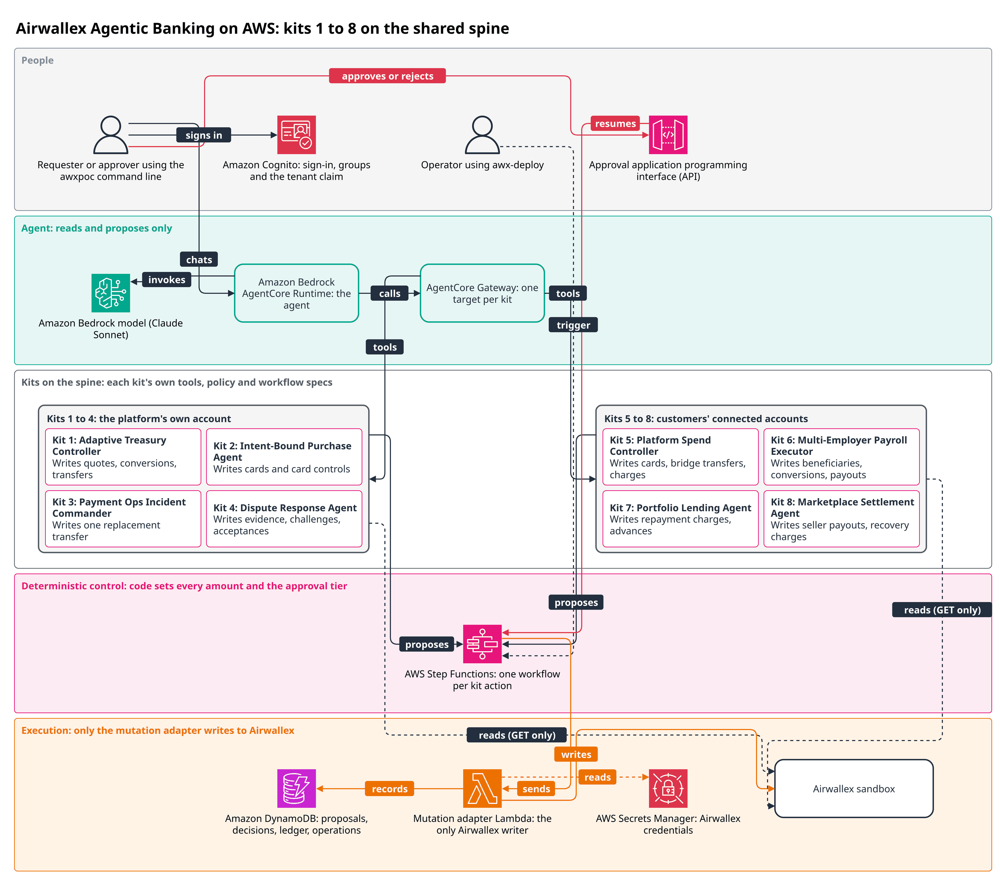

# Airwallex Agentic Banking on AWS

AWS-native reference implementations of kits 1 to 8 from the
[Airwallex Agentic Banking Hackathon builder guide](https://airwallexdev.com/guide), built on
one shared spine. Every kit runs against the Airwallex sandbox only. This is a proof of concept,
not production code.

## Architecture overview



The shared spine is the sign-in, agent, approval, workflow and adapter infrastructure that every
kit uses. The agent reads and proposes through each kit's tools, and code in AWS Step Functions
sets every amount and the approval tier. People approve through the approval application
programming interface (API), and only the mutation adapter writes to Airwallex. The AWS Cloud
Development Kit (CDK) app in `infra/` synthesises the AWS CloudFormation templates for the spine
stack, the agent stack and each kit (`make synth`). [docs/deployment.md](docs/deployment.md)
walks through the deployment. The [reference architecture diagrams](docs/architecture/README.md)
show the shared spine and each kit in detail.

## Kits

Validation as of 7 October 2026. "Live sandbox" is the kit's acceptance scenario run
in-process against the real Airwallex sandbox. "Deployed stack" is what was run through the
deployed AWS stacks.

| Kit | What it shows | Offline tests | Live sandbox | Deployed stack |
|---|---|---|---|---|
| [1 Adaptive Treasury Controller](kits/k1_treasury/README.md) | A fee-inclusive FX (foreign exchange) plan checked against the reserve floor across the whole plan, with rate locks and quote expiry | pass | yes | agent: plan, rate lock, approval, conversion and supplier payment; `execute_plan` at AUTO (8 October 2026) |
| [2 Intent-Bound Purchase Agent](kits/k2_purchase/README.md) | Card controls bound to a purchase decision, with per-transaction and cumulative limits and a limit-boundary test | pass | yes | agent: `issue_card` and a limit test, each approved (8 October 2026) |
| [3 Payment Ops Incident Commander](kits/k3_incident/README.md) | Replacing a failed transfer only once the provider reports it failed, behind a duplicate lock | pass | yes | agent: staged original, simulated failure and replacement, each approved (8 October 2026) |
| [4 Dispute Response Agent](kits/k4_dispute/README.md) | Dispute economics and deadlines, an evidence pack, and evidence that carries a prompt injection | pass | no: needs online payments enabled on the sandbox account | deployed, not exercised |
| [5 Platform Spend Controller](kits/k5_platform_spend/README.md) | A platform capital ledger and reserve allocator for connected accounts, with tenant mapping | pass | yes, except one card authorisation the sandbox left pending | agent: shortfall and a 25 USD bridge approved by the kit 5 operator (8 October 2026) |
| [6 Multi-Employer Payroll Executor](kits/k6_payroll/README.md) | Per-employer pricing and funding, one child run per employer, a wallet-delta postcondition | pass | yes | agent: a payroll for one employer, approved (8 October 2026) |
| [7 Portfolio Lending Agent](kits/k7_lending/README.md) | A loan subledger and repayment formula, advances and weekly collection | pass | yes | agent: an advance approved by the kit 7 operator; a weekly collection started with `awx-deploy trigger` (8 October 2026) |
| [8 Marketplace Settlement Agent](kits/k8_settlement/README.md) | A seller reserve ledger, the cycle identity check, receivables and recovery | pass | yes | seller payout started with `awx-deploy trigger` and approved by the kit 8 operator (8 October 2026); agent: read tool |

The deployed security checks (`scripts/deployed_security_checks.py`) and a set of
approval-visibility checks passed against the deployment on 7 October 2026. On 8 October
2026 check 5 failed on a deployment from a fresh clone into a new account. After the fix, every
deployed check passed on that deployment, including check 5c. Kit 8 settlement
is approved by the kit operator. On 7 October the seller's own approver approved a deployed
payout, before the operator rule existed. On 8 October 2026, on a deployment from a fresh
clone into a new account, the seller's approver was refused and the kit 8 operator approved a
3,800 USD payout with 1,000 USD held in reserve.

## Design principles

The model reads and proposes. Agent tools are `read_*` and `propose_*` only. A read tool
returns provider data to the model as untrusted data. A propose tool starts a workflow and
returns its proposal id and hash. No tool input may name an account, a tenant or a request id.

Deterministic code computes every amount, chooses every account and derives every request id.
Each kit's policy returns a risk tier and the computed values, and the workflow re-runs it
before anything executes.

Only the Step Functions workflow and its mutation adapter can write to Airwallex. The adapter
Lambda is the only principal that holds both the Airwallex secret and a write path, and only a
kit's state machine role may invoke it. Reads go through a per-kit reader Lambda that can only
send GET requests from that kit's allowlist.

An approval binds to the proposal hash (stored and passed as `intent_hash`), which covers the
kit, the action, the intent, the computed values, the risk tier and the origin. It must come
from someone other than the proposer, before the proposal expires.

Every proposal gets its policy's risk tier. A proposal the model starts is raised to at least
SINGLE (one approver who is not the proposer), unless that action's spec sets
`agent_min_tier=AUTO` and the kit's docs justify it. The actions that lower the floor move no
money (they create quotes, tighten a card, record a closure, a decision or a shortfall, or
reconcile), except kit 1 `execute_plan`, which converts and pays within its policy's
autonomous limits.
[Rule 11](docs/workflow-rules.md#rule-11-proposal-origin-and-the-agent-approval-floor) lists
each one.

Money that leaves a platform, lender or marketplace balance toward a customer (a bridge, an
advance, a seller payout) is approved by the kit's operator, not by the customer who receives
it.

Every write is idempotent. A request id derives from the business object, and after an
unknown outcome the executor reads back what landed before it ever sends again.

Tenants are resolved server-side, from the caller's verified token and the tenants table,
never from model output.

[docs/security.md](docs/security.md) and [docs/workflow-rules.md](docs/workflow-rules.md)
give the detail.

## Repository layout

```text
packages/
  awx_common/      the shared contract: money, intents, approvals, tenancy, kit workflow specs
  awx_spine/       the Airwallex layer: sandbox client, mutation executor, finality, FakeAirwallex
  awx_spine_aws/   the AWS runtime: Lambda handlers, workflow engine, DynamoDB stores, awx-deploy
  awx_agent/       the agent plane: Strands agent, AgentCore Gateway tools, awxpoc CLI
kits/              one package per kit, k1_treasury to k8_settlement
infra/             the AWS CDK app: AwxSpine, AwxKitK1 to AwxKitK8, AwxAgentStack
deploy/            per-kit deploy files for awx-deploy
scripts/           secret scan, secret seeding and deployed security checks
tests/             cross-cutting contract and security suites
docs/              repository documentation and architecture diagrams
```

## Getting started

Prerequisites: Python 3.12, [uv](https://docs.astral.sh/uv/), and Node.js for the AWS Cloud
Development Kit (CDK) command line, which the Makefile runs through `npx`. Set `REGION` in
the shell before `make synth` (`export REGION=us-west-2`, or the Region of the deployment
being updated):

```sh
make help
make sync
make hooks
make check
make synth-test
make synth ACCOUNT=111122223333 ALERT_EMAIL=you@example.com REGION="$REGION"
```

`make help` lists every target. `make sync` creates the uv workspace environment.
`make hooks` sets `git config core.hooksPath .githooks`, so git runs the secret scan on every
commit. `make check` runs the linters, the secret scan and the offline tests (no network once
synced).
`make synth-test` runs cdk synth and the synth-time security tests, and `make synth`
synthesises every stack for `REGION`.

`make check` and `make synth-test` take about 4 to 5 minutes each, and pytest prints only
dots while it runs. `make synth` needs no AWS credentials, but downloads the pinned
linux/arm64 wheels for the
agent-plane Lambda and Runtime assets. [docs/testing.md](docs/testing.md) covers the other test
layers.

## Deploying

Set `REGION` in the shell first: `export REGION=us-west-2` for a new deployment, or the Region
an existing deployment was deployed to, to update it.

```sh
make bootstrap ACCOUNT=<12-digit id> REGION="$REGION"
make deploy ACCOUNT=<12-digit id> ALERT_EMAIL=<address> REGION="$REGION"
```

Run `make bootstrap` once per account and Region. `make deploy` deploys every stack.

`cdk deploy` asks a person at a terminal to approve AWS Identity and Access Management (IAM)
changes. In a shell with no terminal
(a continuous integration (CI) job, a coding agent) add
`CDK_ARGS="--require-approval never"` to `make deploy`. Before the kits can run you seed the
Airwallex secret, create demo users and load each kit's state with `awx-deploy`.
[docs/deployment.md](docs/deployment.md) is the full runbook.

## Documentation

- [docs/architecture.md](docs/architecture.md): stacks, request flow, the kit state machine,
  data stores and technology versions
- [docs/security.md](docs/security.md): threat model, controls, identity and tenancy, secrets,
  deployed checks and known limits
- [docs/workflow-rules.md](docs/workflow-rules.md): runner rules 0 to 11 and kit money rules
  M1 to M4
- [docs/testing.md](docs/testing.md): test layers, how to run them, FakeAirwallex
- [docs/adding-a-kit.md](docs/adding-a-kit.md): how to add a new kit
- [docs/deployment.md](docs/deployment.md): deploy, seed and operate a demo
- [docs/architecture/README.md](docs/architecture/README.md): the diagrams and how to
  regenerate them
- [infra/README.md](infra/README.md): the CDK app, context parameters, partial deploys and
  teardown
- [kits/README.md](kits/README.md): index of the kits
- [tests/README.md](tests/README.md): the cross-cutting test suites
- [packages/awx_spine/FAKE-FIDELITY.md](packages/awx_spine/FAKE-FIDELITY.md): the sandbox
  evidence behind each FakeAirwallex behaviour

## Limitations

- Sandbox only. The Airwallex client refuses any host but the sandbox.
- One AWS Region per deployment (`REGION`, default `us-west-2`). Default model IDs exist for the
  Regions listed in [docs/deployment.md](docs/deployment.md); another Region needs `MODEL_ID`
  and `FALLBACK_MODEL_ID`.
- No web UI. People use the `awxpoc` command line.
- No schedules. Scheduled actions (kit 6 payroll, kit 7 collection and reconciliation, kit 8
  settlement and reconciliation) are started by an operator with `awx-deploy trigger`, so no
  money moves unattended.
- Kit 4 has not run against the live sandbox: its disputes need online payments enabled on the
  sandbox account.
- Kits 9 and 10 of the guide are not included. They need Airi CLI and merchant Agentic Commerce
  access.
- IAM does not separate the tenants of one kit; code does (see
  [docs/security.md](docs/security.md#known-limits)).
- A partial deploy (`KITS=...`) removes every other kit's agent tools until the next full
  deploy ([infra/README.md](infra/README.md)).
- Kit 7's loan subledger and repayment formula are AWS-authored assumptions, because the guide
  does not specify them.
- Each kit README lists the limits of that kit.
