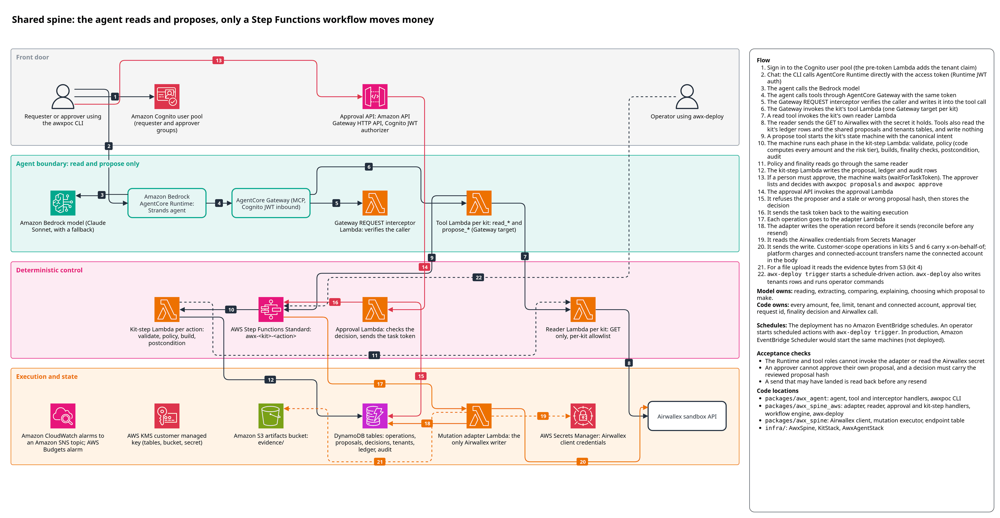
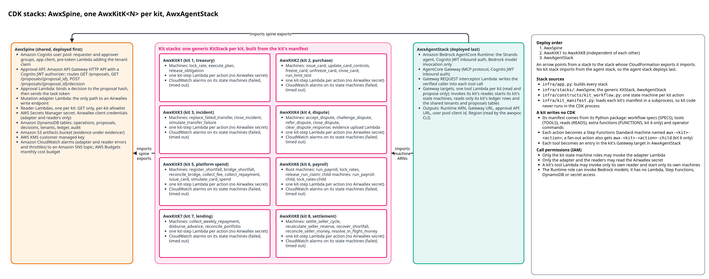
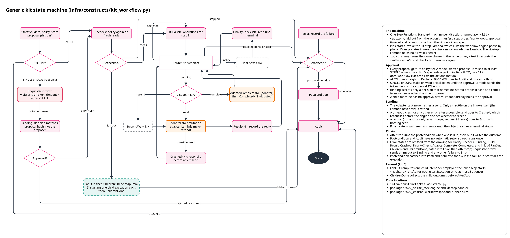

# Architecture

## Overview



Every kit runs on one shared spine. A person talks to a Strands agent through the `awxpoc`
command line. The agent can only read and propose. A proposal starts the kit's AWS Step
Functions workflow, which re-runs the kit's policy, waits for a human approval when the risk
tier needs one, and sends each write to Airwallex through the mutation adapter Lambda. State
lives in Amazon DynamoDB tables encrypted with one AWS Key Management Service (AWS KMS)
customer managed key.

The same workflow engine (`awx_spine_aws.engine`) runs inside Step Functions and in-process in
`awx_spine_aws.local_runner`, so a kit tested offline exercises the code that runs in AWS.

## Stacks



The AWS Cloud Development Kit (CDK) app in `infra/` builds these stacks.

| Stack | Source | Holds |
|---|---|---|
| `AwxSpine` | `infra/stacks/spine_stack.py` | the KMS key, the Airwallex secret (created empty), the tables, the artifacts bucket, one reader Lambda per kit, the mutation adapter Lambda, the approval API and its Lambda, the Amazon Cognito user pool with its Pre Token Generation trigger, CloudWatch alarms to an SNS topic, an AWS Budgets alarm |
| `AwxKitK1` to `AwxKitK8` | `infra/stacks/kit_stack.py` (one generic `KitStack`) | one state machine per kit action (`awx-<kit>-<action>`, plus `awx-<kit>-<action>-child` for a fan-out child), the kit-step Lambda and role for each, and any Lambdas the kit declares in `FUNCTIONS` |
| `AwxAgentStack` | `infra/stacks/agent_stack.py` | the Amazon Bedrock AgentCore Gateway with its identity interceptor Lambda, the AgentCore Runtime that hosts the agent, and one tool Lambda (a Gateway target) per kit |

Dependencies run only one way: spine, then the kit stacks, then the agent stack. A kit stack
imports the spine's tables, key, approval role and that kit's reader. The agent stack imports
every kit stack's root state machines, because each kit's propose tools start them. `cdk
deploy --all` deploys in that order and `cdk destroy --all` removes in the reverse order.
[infra/README.md](../infra/README.md) covers partial deploys and changing an action.

## Request flow
1. A person runs `awxpoc login`, which signs in to the Cognito user pool. The Pre Token
   Generation trigger copies the user's immutable `custom:tenant_id` attribute into a
   `tenant_id` claim on the access token.
2. `awxpoc chat --kit <kit>` sends the message and the access token straight to AgentCore
   Runtime, whose own JSON Web Token (JWT) authorizer accepts the token.
3. The Strands agent calls the Amazon Bedrock model and lists the kit's tools from the
   AgentCore Gateway, passing the same user token. If the kit has no tools the turn is refused.
4. The model calls a tool. The Gateway's Cognito JWT authorizer admits the call, and its
   REQUEST interceptor Lambda verifies the token signature itself and places the verified token
   in the tool arguments as a server-filled field.
5. The kit's tool Lambda verifies the token again and resolves the tenant server-side from the
   tenants table.
6. A `read_*` tool runs the kit's read function with a read-only policy context. Every
   Airwallex read goes through the kit's own reader Lambda (GET only, per-kit allowlist). The
   result goes back to the model marked as untrusted data.
7. A `propose_*` tool runs the kit's validate and policy, applies the agent approval floor,
   builds a `Proposal` with its hash and a derived proposal id, and starts the kit's state
   machine with the proposal id as the execution name. It returns the proposal id and hash.
8. The state machine's Start state records the proposal. Its risk tier decides what follows:
   AUTO continues, BLOCKED goes to the audit record, SINGLE or DUAL waits for approval with a
   `waitForTaskToken` task that times out after the action's approval window.
9. An approver runs `awxpoc proposals list` and `awxpoc approve <proposal_id>`. The approval
   API (Amazon API Gateway HTTP API with a Cognito JWT authorizer) calls the approval Lambda,
   which checks the approver group, the approver tenant, the echoed hash, self-approval and
   expiry, stores the decision, and sends the task token once the proposal is approved or
   rejected.
10. The workflow re-checks the binding from the decisions table and re-runs validate and
    policy. A changed hash fails the run closed.
11. For each step, the kit-step Lambda builds the operations. The state machine sends each
    one to the mutation adapter Lambda, which re-reads the proposal and its decisions, checks
    tenant scope, records the operation, and sends it to Airwallex with its request id.
12. The kit-step Lambda polls each operation's object through the reader until it reaches a
    terminal status. In sandbox mode the engine also builds the simulation calls that move a
    sandbox object along, and the adapter sends them.
13. The postcondition runs once the steps stop, whatever the outcome, and the audit record is
    written.

Scheduled actions start at step 7 with `awx-deploy trigger`, run by an operator, with origin
SCHEDULE instead of AGENT.

## Kit workflow state machine



`infra/constructs/kit_workflow.py` lays out one Step Functions Standard state machine per kit
action from the kit's manifest. Every Lambda state calls one phase of `awx_spine_aws.engine`.

```text
Start -> RiskTier?
  AUTO        -> Recheck
  BLOCKED     -> Audit
  SINGLE/DUAL -> RequestApproval (waitForTaskToken, timeout = approval window)
                 -> Binding -> Approved? -> Recheck
Recheck -> [FanOut -> Children (Map: one child execution each) -> ChildrenDone]
        -> for each step: Build -> Route? --pending--> Dispatch?
             send or advance -> Adapter -> Result -> Route?
             resend          -> ResendWait -> Adapter
             complete        -> AdapterComplete -> Completed -> Route?
             adapter failure after a possible send -> Crashed -> Route?
           Route? finality -> FinalityWait -> FinalityCheck -> Route?
        -> AfterStop -> Postcondition -> Audit -> Done
```

The Adapter task never retries a send. An adapter timeout, crash or unexpected error goes to
Crashed, which reconciles before the engine decides whether a resend is safe. A refusal
(`NotAuthorised`, `TenantScopeViolation`, `RequestIdReuse`) goes to the error path with
nothing sent. Only a throttle on the invoke itself, where the Lambda never ran, is retried.
Postcondition and Audit have no automatic retry. A child state machine has no approval states:
its parent's approval covers it.

A run that fails (an operation that fails, a postcondition that does not hold) still passes
through Postcondition and Audit to Done, so its Step Functions execution ends `SUCCEEDED`.
The proposal's status in the proposals table (`awxpoc proposals show <proposal_id>`) is the
source of truth for a run's outcome: an execution can succeed while recording a `FAILED`
proposal.

`packages/awx_spine_aws/tests/test_asl_equivalence.py` interprets the synthesised state
machine definition and checks it reaches the same outcome as `local_runner`.

## Data stores

Every table is on-demand, has point-in-time recovery and uses the spine's KMS key. The tables,
the bucket, the secret, the user pool and the key are retained when the stacks are destroyed.

| Store | Key | Written by | Read by |
|---|---|---|---|
| Operations table | `request_id` | the adapter (record before every send, then the result) | the adapter |
| Proposals table | `proposal_id`; indexes `by_tenant` and `by_approver` | kit-step Lambdas (the proposal, its state and the task token) | the approval Lambda, the adapter, kit-step Lambdas; the tool Lambda reads only `proposal_id` and `outcome` |
| Decisions table | `proposal_id`, `approver` | the approval Lambda | kit-step Lambdas and the adapter |
| Tenants table | `tenant_id` | `awx-deploy tenants put` | readers, the adapter, kit-step and tool Lambdas |
| Ledger table | `pk` (`<kit>#<tenant>`), `sk` | kit-step Lambdas, kit functions and `awx-deploy` operator commands, each limited to its own kit's partitions | the same, and the kit's tool Lambda |
| Audit table | `proposal_id`, `at` | kit-step Lambdas (append only) | operators |
| Artifacts bucket | `evidence/<kit>/<tenant>/<id>` | kit functions granted evidence upload (kit 4) | the adapter only |
| Airwallex secret | | an operator, out of band | the readers and the adapter only |

The operations table has no expiry: Airwallex deduplicates a request id for only about 7 days,
so this table is the long-term guard against a second write.

## Kit manifests

A kit writes no CDK. It exports pure data: `SPECS`, `TOOLS`, `READS` and, if it needs its own
Lambdas, `FUNCTIONS`. For each kit in a build, `infra.kit_manifest.load_manifests` runs
`python -m infra.kit_manifest <kit>` in a subprocess. The subprocess imports the kit, checks
its exports exactly as the Lambda runtime will, and prints a JSON manifest of only the fields
the infra code reads. The CDK process validates that JSON with a strict schema and builds the
kit stack, its state machines and its Gateway tools from data alone. Whatever kit code does at
import time happens in a process that holds no construct tree.

[docs/adding-a-kit.md](adding-a-kit.md) walks through the exports.

## Technology

| Component | Version |
|---|---|
| Python | 3.12, one uv workspace |
| AWS CDK | `aws-cdk-lib` 2.272.0, `constructs` 10.8.1, `cdk-nag` 2.38.2, CLI `aws-cdk@2.1144.0` through `npx` |
| Agent | Strands Agents (`strands-agents` 1.58.0) on Amazon Bedrock AgentCore Runtime (`bedrock-agentcore` 1.24.0), tools through AgentCore Gateway Lambda targets |
| Model | Claude Sonnet 5 (`anthropic.claude-sonnet-5`), falling back to Claude Sonnet 4.5 (`anthropic.claude-sonnet-4-5-20250929-v1:0`), through the deploy Region's geographic inference profiles (`us.` by default, see "Region and models" in [deployment.md](deployment.md)) |
| AWS SDK | `boto3` 1.43.108 |
| Token verification | `pyjwt` 2.15.1 with `cryptography` 50.0.2, RS256 only |
| Compute | AWS Lambda on arm64, Python 3.12; Step Functions Standard |
| Tests | `pytest` 9.1.1, `hypothesis` 6.168.5, `moto` 5.2.3, `ruff` 0.16.10 |

Every dependency is pinned exactly. Amounts cross Step Functions, Lambda payloads and DynamoDB
only as tagged strings (`awx_common.transport`), because Step Functions numbers are doubles and
a float must never touch a money path.
