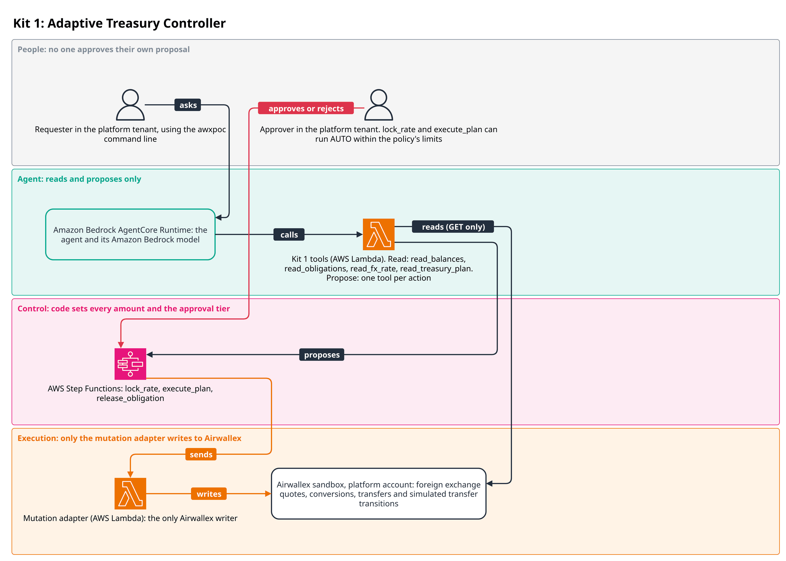
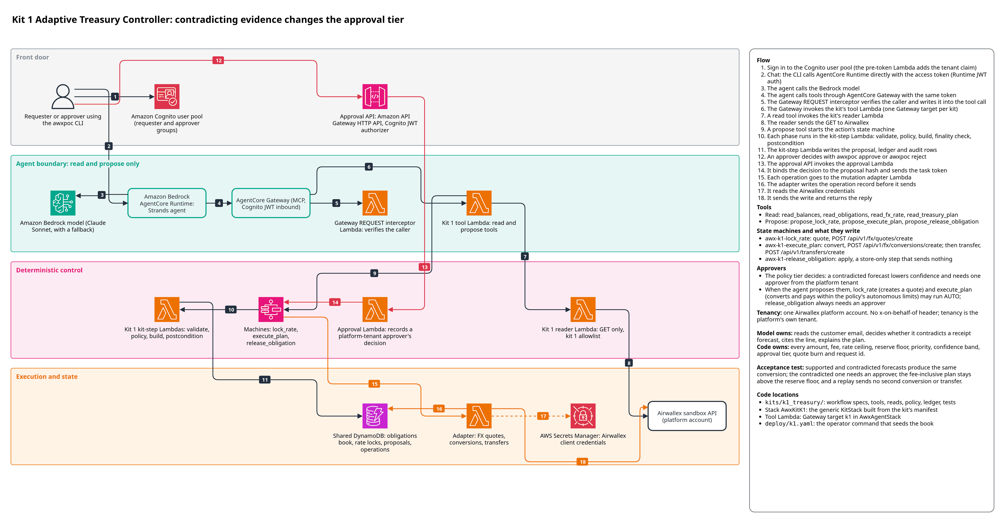

# Kit 1: Adaptive Treasury Controller

In the guide's scenario, a business has five obligations in three currencies falling due within
72 hours, and its cash cannot cover them all while keeping a reserve floor in every wallet. Kit
1 plans what to do with each one: it funds the shipping invoice, converts the minimum needed for
the time-sensitive EUR supplier (SWIFT international wire fee included), defers the cheapest
obligation and escalates the one with a policy exception. When the expected Acme receipt
arrives, only the supplier decision changes. The same conversion runs without a person when bank
and invoice data support the receipt forecast, and needs a person when a customer email
contradicts it.



A requester in the platform tenant asks the agent, which reads balances, obligations, rates and
the treasury plan and proposes a rate lock, a plan execution or an obligation release. Each
proposal starts an AWS Step Functions workflow in which code sets every amount and the approval
tier. An approver in the platform tenant decides, except that `lock_rate` and `execute_plan` can
run AUTO within the policy's limits. The proposer never approves their own proposal. Only the
mutation adapter writes foreign exchange quotes, conversions, transfers and simulated transfer
transitions to Airwallex.

The detailed reference architecture follows, and [DESIGN.md](DESIGN.md) holds the design notes.



The diagram source is `docs/architecture/k1_treasury.drawio`.

## Flow
1. A person asks the agent about upcoming payments. The agent calls `read_balances`,
   `read_obligations` and `read_treasury_plan`, which read Airwallex through the spine's
   reader and the treasury book from the kit store.
2. The model reads the customer email, decides whether it contradicts a receipt forecast, and
   cites the line. It passes only obligation ids and cited contradictions to the tools.
3. `propose_lock_rate` starts `awx-k1-lock_rate`, which creates one Airwallex foreign exchange
   (FX) quote per currency the plan must buy and stores it as the rate lock. No money moves.
4. `propose_execute_plan` starts `awx-k1-execute_plan`. Its policy plans against the stored
   quote, runs the whole-plan reserve check with fees, and sets the approval tier from the
   forecast confidence. Every amount goes into the proposal, which the proposal hash binds.
5. If the tier needs it, a person other than the proposer approves the proposal through the
   approval API. AUTO proposals run straight away.
6. The workflow re-runs the policy (rule 1), takes the obligation locks, then converts: for
   each conversion not already landed it re-checks the quote's remaining validity, the
   balances and the whole plan, burns the quote and books it.
7. It then sends one transfer per obligation, again only after reconciling by request id and a
   final reserve check, and polls each transfer to PAID.
8. The postcondition reads the provider and moves each obligation lock to PAID, SUBMITTED,
   NEEDS_PERSON or RELEASED, and checks every touched wallet is still at or above its floor.
9. A lock that needs a person is cleared through `propose_release_obligation`, which starts
   `awx-k1-release_obligation` and always needs an approver.

## Model and code responsibilities
| The model | Code |
|---|---|
| Reads the customer email and decides whether it contradicts a receipt forecast | Owns every amount, fee, rate ceiling, floor, priority, confidence band and approval tier |
| Cites the source and the exact line of each contradiction | Owns every quote burn, obligation lock and request id |
| Picks which book obligations to propose, by id | Resolves the ids against the book and BLOCKS unknown ones |
| Explains the plan to the person | Sends nothing until the policy, the approval and the reserve checks pass |

A contradiction can only lower confidence. HIGH confidence needs the book's
`bank_corroborated` and `invoice_matched` flags, which the model cannot set.

## Actions and tools

| Tool | Kind | Starts | Lowest tier when the agent proposes |
|---|---|---|---|
| `read_balances` | READ | | |
| `read_obligations` | READ | | |
| `read_fx_rate` | READ | | |
| `read_treasury_plan` | READ | | |
| `propose_lock_rate` | PROPOSE | `awx-k1-lock_rate` | AUTO |
| `propose_execute_plan` | PROPOSE | `awx-k1-execute_plan` | AUTO |
| `propose_release_obligation` | PROPOSE | `awx-k1-release_obligation` | SINGLE |

The tools are in `src/awx_k1_treasury/tools.py`, the reads in `reads.py`, and the workflows in
`ratelock.py`, `workflow.py` and `release.py`. A proposal the model starts is raised to at
least SINGLE, except `lock_rate` and `execute_plan`. `lock_rate` only creates a quote.
`execute_plan` converts and pays within the policy's autonomous limits, the kit's only AUTO
action that can move money. The bounds are in
[DESIGN.md](DESIGN.md#auto-for-agent-proposals).

## Approval rules

`execute_plan` (`policy.approval_tier`, strictest rule wins; limits in the funding currency):

| Tier | When |
|---|---|
| BLOCKED | a requested obligation is not funded by the plan, the whole plan breaches a floor, an obligation is already locked, paid or in flight, or there is no usable rate lock |
| DUAL | exposure (conversion sell ceilings plus funding-currency payouts) above USD 100,000 |
| SINGLE | conversions above the confidence band's automatic limit (HIGH USD 10,000, MEDIUM 2,500, LOW 0), a payout above its currency's automatic limit (USD 15,000, EUR 10,000, GBP 1,000), or the funding wallet ending within 10% of its floor |
| AUTO | otherwise |

`lock_rate` is AUTO. `release_obligation` is SINGLE, or DUAL when a transfer or conversion was
recorded, the provider still does not show it and the deduplication window has passed; it is
BLOCKED while anything may still land. Kit 1 runs as the platform tenant, so the approver is a
platform approver who is not the proposer; DUAL needs two.

## Money safety

- Request ids derive from a random book id, the obligation and the lock attempt, never from an
  intent hash, so a fresh book never adopts an earlier book's sandbox objects (kit rule M2).
- One lock per obligation, owned by the run's proposal id (M4). A second proposal for an
  obligation that is paid or in flight is BLOCKED, whatever evidence it cites.
- Every conversion and transfer is reconciled by request id before any send (rule 9), and the
  exact body is recorded before it is emitted.
- One quote books at most one conversion request (the sandbox accepts a quote again), and the
  approval binds the quote's exact sell (M3).
- The whole plan, fees included, is checked against every wallet's floor at policy, before the
  conversions and again before the transfers.
- An unknown outcome is never retried by a new proposal: the lock goes to NEEDS_PERSON (M1),
  and only a person, from provider evidence, releases it.

[DESIGN.md](DESIGN.md) has the detail: request ids, locks and attempts, the build order,
finality, the release evidence table and the runbook for a lock whose owner run cannot be
found.

## Infrastructure

`AwxKitK1` is built by the generic `KitStack` from the kit's manifest. It deploys:

- root state machines, one per action: `awx-k1-lock_rate`, `awx-k1-execute_plan` and
  `awx-k1-release_obligation`, each with a log group and alarms for failed and timed-out runs.
  There are no child state machines, and kit 1 declares no extra functions;
- one kit-step Lambda per state machine, which runs the deterministic workflow phases and holds
  no Airwallex secret. Its role reads and writes the spine's ledger and proposals tables,
  queries decisions, reads tenants, writes audit, invokes the spine's kit 1 reader, and may
  describe `awx-k1-*` executions (the release tool's owner-run check). Each state machine may
  invoke its step Lambda and the spine's mutation adapter, the only principal that writes to
  Airwallex.

`AwxAgentStack` adds the kit 1 tool Lambda (read and propose only) and the AgentCore Gateway
target `k1`. `AwxSpine` adds the kit 1 reader, which may call only these GET paths:
`/api/v1/balances/current`, `/api/v1/fx/rates/current`, `/api/v1/fx/conversions`,
`/api/v1/fx/conversions/{id}`, `/api/v1/transfers` and `/api/v1/transfers/{id}`.

To synthesise or deploy only this kit:

```
make synth ACCOUNT=111122223333 ALERT_EMAIL=you@example.com KITS=k1
make deploy ACCOUNT=<12-digit id> ALERT_EMAIL=<address> KITS=k1
```

A partial deploy over a full one removes the other kits' tools from the Gateway. See
[`infra/README.md`](../../infra/README.md).

## Setting up a deployed kit

Kit 1 runs as the platform tenant, so it needs no tenants rows. A deployed kit 1 starts with an
empty store: until it is seeded, every read answers `NOT_CONFIGURED` and every proposal is
BLOCKED. Seed it with the `seed_treasury_book` operator command from `deploy/k1.yaml`:

```
uv run --all-packages awx-deploy plan deploy/k1.yaml \
    --var K1_BEN_SUPPLIER_EUR=<id> --var K1_BEN_SHIPPING=<id>
uv run --all-packages awx-deploy --profile <profile> apply deploy/k1.yaml \
    --var K1_BEN_SUPPLIER_EUR=<id> --var K1_BEN_SHIPPING=<id>
```

Each beneficiary must already exist in the sandbox with a `poc-i1-` nickname. The command moves
no money.

The seed moves the demo book's due dates so its scenario starts at the seed time, rounded up to
the next whole hour: every seeded obligation falls due within the next 72 hours, the window
`read_obligations` reports on. To pin the start, add `scenario_start: "<YYYY-MM-DD>"`, read as
midnight Coordinated Universal Time (UTC), to the step's `args` in `deploy/k1.yaml`.

`deploy/k1.yaml` maps `ob-supplier-eur` and `ob-shipping` only, so the deployed demo seeds the
supplier and shipping obligations only. To show the full scenario this README describes (defer
the office supplies, escalate the new contractor), create a `poc-i1-` LOCAL beneficiary for
each other obligation, GBP for `ob-saas-gbp` and `ob-contractor-gbp` and USD for
`ob-office-usd`, and add each one to the `beneficiaries` map in `deploy/k1.yaml`. The plan then
needs a GBP wallet above its 500 GBP floor.

A re-seed with `replace: true` moves the dates only. A paid obligation stays PAID on this
deployment, because its `obligation/<id>` lock survives a replace, so `execute_plan` pays each
obligation id once per deployment. To run the payment again, map an obligation that has not
been paid. The args file
[examples/reseed_treasury_book.yaml](examples/reseed_treasury_book.yaml) is the deploy file's
`seed_treasury_book` args with `replace: true` and `ob-office-usd` (450.00 USD LOCAL) added.
`K1_BEN_OFFICE_USD` may be the US LOCAL beneficiary you passed as `K1_BEN_SHIPPING`:

```
uv run --all-packages awx-deploy --profile <profile> run k1 seed_treasury_book \
    kits/k1_treasury/examples/reseed_treasury_book.yaml \
    --var K1_BEN_SUPPLIER_EUR=<id> --var K1_BEN_SHIPPING=<id> --var K1_BEN_OFFICE_USD=<id>
```

The report's `due` lists the new due dates. Once `ob-office-usd` is paid too, copy the file
and map another unpaid obligation, with a new `book_version`.

Fund the platform wallets with a sandbox deposit separately, under
`flock /tmp/awx-sandbox.lock`. Create the `demo-platform-requester` and
`demo-platform-approver` users as in
[docs/deployment.md, Create demo users](../../docs/deployment.md#create-demo-users). See
[DESIGN.md](DESIGN.md#seeding-a-deployed-book) for what the command checks.

## Tests

Offline (`make check`), all through the real `local_runner` over `FakeAirwallex` unless noted:

| Topic | Files |
|---|---|
| Scenarios: the acceptance scenario on the fake, rate locks, repeat payments, staleness, the demo story | `tests/test_scenarios.py` |
| The plan, the approval matrix and property tests over random books | `tests/test_plan_policy.py`, `tests/test_money_rules.py` |
| Faults (timeouts, 500s, 429s, list lag), M1 and M4, uncertain sends, builds called directly | `tests/test_faults.py` |
| Redelivery: every build twice (rule 0), two objects under one request id | `tests/test_redelivery.py` |
| The release tool, its races with a sending run, and its paged cross-check | `tests/test_release.py`, `tests/test_release_races.py`, `tests/test_release_paging.py` |
| Exports, the read allowlist, tenant scope, packaging | `tests/test_contract.py` |
| Every tool through the real tool dispatcher with `KitToolHarness` | `tests/test_tool_surface.py` |
| Seeding a deployed store, the seeded dates and the due window | `tests/test_seed.py`, `tests/test_operator_commands_k1.py` |
| The example re-seed file: a paid obligation stays paid, a newly mapped one pays | `tests/test_reseed.py` |
| The live run's evidence file and failure messages | `tests/test_live_evidence.py` |

`tests/test_synth_k1.py` (marker `synth`, `make synth-test`) synthesises `AwxKitK1` and
`AwxAgentStack` and checks the kit's state machines, that no kit 1 role can read the Airwallex
secret, and that the Gateway registers exactly kit 1's tools.

`tests/test_acceptance.py` (marker `sandbox`, `make sandbox-test`) runs the acceptance scenario
against the fake by default. With `AWX_LIVE=1` it runs against the real sandbox through the same
`local_runner`, holding `flock /tmp/awx-sandbox.lock` throughout. It finds or creates the
`poc-i1-supplier-de` EUR SWIFT beneficiary, seeds a fresh one-obligation book per run (10.00 EUR,
EUR floor at the current EUR balance) and, per run, creates one quote, one conversion and one
transfer. It asserts that every wallet ends at or above its floor and that each payout is
PAID, whichever SWIFT fee the sandbox charges. With `AWX_K1_SHAPES=<path>` it writes the run's
evidence there, on a failed run too (`outcome: failed` and the error); the 6 Oct run is in
`evidence/live-run-1.json`. Each failure message carries the run's full detail, postcondition
included.

## Validation

- 6 Oct 2026, live sandbox, by the committed `tests/test_acceptance.py` with `AWX_LIVE=1`: the
  one-obligation book paid 10.00 EUR by SWIFT twice, once with supported evidence (AUTO) and
  once contradicted (SINGLE, approved). Each run converted 18.37 USD to 16.21 EUR, paid the
  transfer to PAID and left the EUR wallet on its floor (the postcondition read it 0.01 EUR
  above). Redelivering the approved proposal sent nothing, and a new proposal for the paid
  obligation was BLOCKED. The sandbox accepted `from_created_at` on `GET /transfers` and
  returned no `has_more`.
- 7 Oct 2026, deployed stack, through the agent on AgentCore Runtime as the platform requester.
  The run was driven with a script that is not part of this repository. The agent read the
  treasury plan and paid the 7,525.70 EUR supplier invoice (plus the 6.21 EUR SWIFT fee). The
  EUR wallet held enough, so no conversion and no approval were needed.
- 7 Oct 2026, same path, after reseeding the deployed book with the 10.00 EUR scenario. The
  agent locked a rate. The plan needed approval because the 18.34 USD conversion was over the
  LOW-confidence automatic limit. The platform approver approved it, and the run converted
  18.34 USD to 16.21 EUR and paid 10.00 EUR.
- 8 Oct 2026, on a deployment from a fresh clone into a new account, through the agent: the
  agent proposed `execute_plan` (AUTO) and it paid 12,000 USD and 7,525.70 EUR. The sandbox
  charged a 6.22 EUR SWIFT fee on some transfers that day. The plans of that day sized the fee
  at 6.21, and in 3 of 5 live acceptance runs the EUR wallet ended 0.01 EUR under its floor
  after paying. The 7,525.70 EUR SWIFT payout was charged 6.22 EUR.
- 8 Oct 2026, after the change to size the fee at 12.85, by the committed
  `tests/test_acceptance.py` with `AWX_LIVE=1`: the live acceptance test passed on each of its 5 runs.
  Each leg converted 22.85 EUR and ended 6.64 EUR above its floor. The sandbox charged 6.21 EUR
  on every transfer that day, so a 6.22 charge did not occur against the new sizing.
- 8 Oct 2026, same deployment, through the agent, after a re-seed that mapped an unpaid
  obligation (`ob-office-usd`): `execute_plan` ran at AUTO and paid 450.00 USD.

Not validated live: the release tool, a CANCELLED transfer and its failure block, deferral,
and GBP payouts.

## Assumptions and limits

- Reserve floors are per wallet and inclusive; a wallet the plan does not touch is not judged.
- Each SWIFT payout is sized at the largest fee on record (`money_rules.SWIFT_FEES`), the rule
  kit 6 uses. For EUR that is the guide's flat EUR 12.85. The sandbox charged 6.21, and 6.22 on
  some transfers on 8 Oct 2026, a 7,525.70 EUR payout among them. When the plan takes a wallet
  down to its floor, the wallet ends at or above the floor whichever of these fees is charged:
  up to 6.64 EUR above it on the sandbox. SWIFT in any other currency escalates.
- The rate lock uses a one-hour quote (`HR_1`); an approval that waits longer goes STALE.
- The lock is matched on the exact buy amount, so a balance change that alters the buy needs a
  re-lock.
- A deferrable obligation is paid only when every non-deferrable obligation without a policy
  exception is funded, and only with 25% headroom above the floor.
- A new billing period for an obligation needs a new obligation version in the book.
- Sandbox transfers need simulation calls to reach PAID; the kit drives them in sandbox mode.
- A lock whose owner run cannot be found (purged after 90 days, or taken by a `local_runner`
  run) stays BLOCKED and is released by hand: see the
  [runbook](DESIGN.md#runbook-a-lock-whose-owner-run-cannot-be-found).

[DESIGN.md](DESIGN.md#guide-ambiguities-and-the-reading-taken) has each reading in full.
