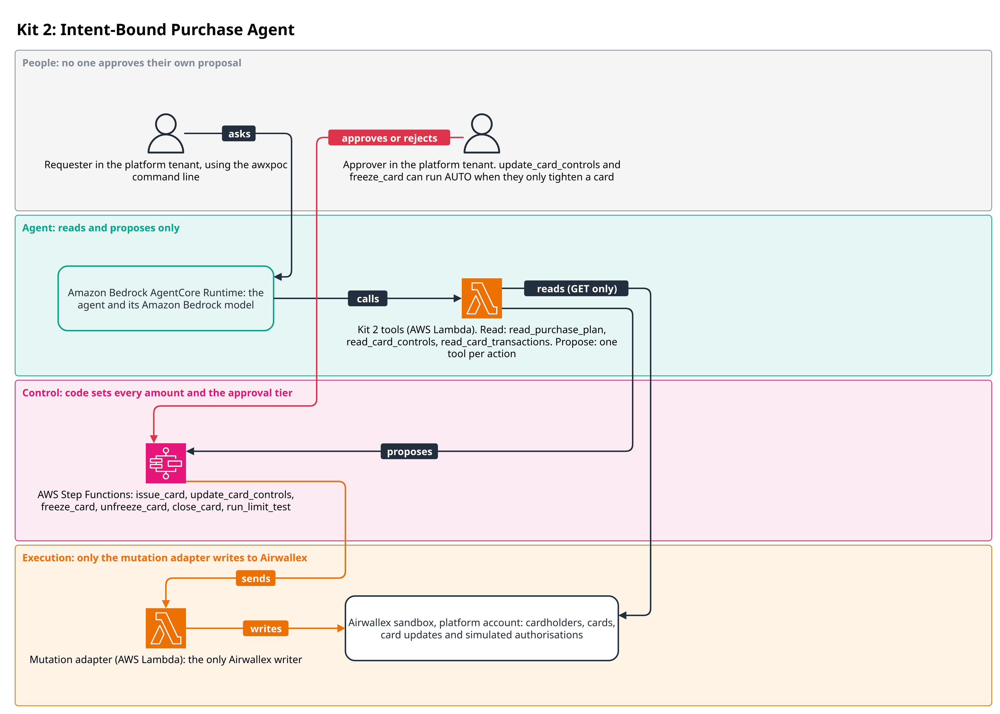
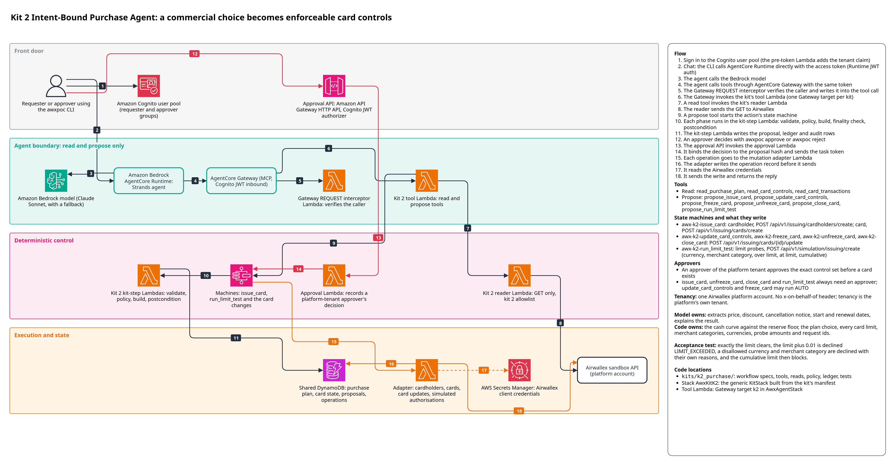

# Kit 2: Intent-Bound Purchase Agent

A founder weighs a SaaS plan. Annual is 18% cheaper but drops cash below the reserve floor in
week seven; monthly keeps the reserve and the option to cancel. Kit 2 compares the plans
against the company's cash, chooses the cheapest plan that keeps the floor, records when to
reconsider, and issues an Airwallex virtual card whose controls enforce exactly that choice.
Only card controls can block an authorisation, so the policy lives in the controls, not in a
prompt. The package is `awx-k2-purchase` (import `awx_k2_purchase`).



A requester in the platform tenant asks the agent about a purchase. The agent reads the purchase
plan, card controls and card transactions and proposes card actions. Each proposal starts an AWS
Step Functions workflow in which code sets every card limit and the approval tier. An approver
in the platform tenant decides, except that `update_card_controls` and `freeze_card` can run
AUTO when they only tighten a card. The proposer never approves their own proposal. Only the
mutation adapter writes cardholders, cards, card updates and simulated authorisations to
Airwallex.

The detailed reference architecture follows, and [DESIGN.md](DESIGN.md) holds the design notes.



The diagram source is `docs/architecture/k2_purchase.drawio`.

## Flow
1. A person asks the agent about a purchase. The model reads the terms and the cash forecast
   and calls `read_purchase_plan` with what it extracted (prices or discount, notice period,
   dates, dated cash flows).
2. Code computes the annual price, the day-by-day cash curve against the reserve floor, the
   plan, the reconsideration date and the card control set, and returns them. Nothing changes.
3. The model calls `propose_issue_card` with the same terms and the SHA-256 (Secure Hash
   Algorithm, 256-bit) hash of the terms document (see
   [Running the demo through the agent](#running-the-demo-through-the-agent)). The tool
   starts an `awx-k2-issue_card` execution, whose policy phase re-evaluates the terms
   server-side, records the proposal (SINGLE, or DUAL above the dual-approval threshold) and
   waits.
4. A different person approves the proposal through the approval API. The approval binds to
   the proposal hash, which covers the terms, the computed control set and the tier.
5. The execution resumes and re-runs the policy, then each step builder re-checks the cash
   position and refuses to send if the plan or the controls no longer match what was
   approved.
6. The mutation adapter creates a DELEGATE cardholder and a virtual card carrying the approved
   `authorization_controls`. Finality polls list each object until it is ready.
7. The postcondition reads the card and its limits back and checks they equal the approved
   control set, and that the purchase's cardholder holds exactly one card. `read_card_controls`
   with the same `purchase_ref` then returns the new card's id.
8. Later changes go through `awx-k2-update_card_controls`, `awx-k2-freeze_card`,
   `awx-k2-unfreeze_card` and `awx-k2-close_card`. The required acceptance test runs through
   `awx-k2-run_limit_test` on a dedicated limit-test card.

## Model and code responsibilities
| The model | Code |
|---|---|
| Extracts the monthly price, the annual price or discount, the cancellation notice period, the start and renewal dates and the other dated cash flows from documents. | Computes the annual price from a discount, the cash curve, the plan choice, the reconsideration date, every card limit, the merchant categories, the currency allowlist, every request_id and the limit-test probe amounts. |
| Explains the result to the person and proposes actions. | Holds the reserve floor, thresholds and merchant category table as server-side policy (`policy_config.py`, version `k2-policy-2026-10-06.1`). No tool input can set them. |

## Actions and tools

| Tool | Kind | Starts | Lowest tier when the agent proposes |
|---|---|---|---|
| `read_purchase_plan` | READ | | |
| `read_card_controls` | READ | | |
| `read_card_transactions` | READ | | |
| `propose_issue_card` | PROPOSE | `awx-k2-issue_card` | SINGLE |
| `propose_update_card_controls` | PROPOSE | `awx-k2-update_card_controls` | AUTO (only for a pure reduction) |
| `propose_freeze_card` | PROPOSE | `awx-k2-freeze_card` | AUTO |
| `propose_unfreeze_card` | PROPOSE | `awx-k2-unfreeze_card` | SINGLE |
| `propose_close_card` | PROPOSE | `awx-k2-close_card` | SINGLE |
| `propose_run_limit_test` | PROPOSE | `awx-k2-run_limit_test` | SINGLE |

Tools live in `src/awx_k2_purchase/tools.py`, read handlers in `reads.py`, and the workflow
specs (`SPECS`, `APPROVAL_MATRIX`) in `workflow.py`.

## Approval rules

| Action | Tier |
|---|---|
| `issue_card` | SINGLE; DUAL when ALL_TIME is over 10,000; BLOCKED over 50,000 or when no plan keeps the floor |
| `update_card_controls` | AUTO when the new controls only reduce authority in every dimension; otherwise SINGLE or DUAL as for `issue_card` |
| `freeze_card` | AUTO (it only revokes authority) |
| `unfreeze_card` | SINGLE (restores authority) |
| `close_card` | SINGLE (irreversible; freeze is the autonomous revocation) |
| `run_limit_test` | SINGLE, with the debit shown; BLOCKED unless the card is a fresh, funded limit-test card |

Kit 2 runs as the platform tenant, so the approver is a platform approver who is not the
proposer. A proposal the model starts is raised to at least SINGLE, except `freeze_card` and
`update_card_controls`, which lower that floor to AUTO because their policy returns AUTO only
when the change reduces what a card can spend. Every card action is BLOCKED on a card whose
`nick_name` does not start `poc-k2-`. The reasoning is in
[DESIGN.md](DESIGN.md#approval-design).

## Money safety

- Every request_id derives from a business key (the purchase, the card's change number, the
  card's limit test) prefixed with kit 2's random book id, never from an intent hash.
- Card changes are numbered: the policy puts the next change number in `computed`, and the
  build claims it once in the kit store, owned by the run's proposal_id. A number claimed by
  another run fails closed.
- Only card create sends `request_id`. Cardholder create and authorisation simulations ignore
  it, so each step has a reconcile hook that finds what landed without writing.
- A write whose outcome stays unknown is recorded in flight on its request_id. A card create
  settles on a later run inside 6 days; past that, or for any unknown probe, a person decides.
- Step builders re-run the evaluation and raise `StaleApproval` if the balance or the card
  moved since approval.
- The limit test proves each control with a probe that breaks exactly one rule, and any
  INSUFFICIENT_FUNDS result is reported as a harness failure.

Detail: [DESIGN.md](DESIGN.md).

## Infrastructure

Kit 2 deploys through the generic `KitStack` from its manifest; it declares no Lambda of its
own. The stack `AwxKitK2` holds, for each action, one root state machine with its step Lambda
(deterministic workflow phases, no Airwallex secret), log groups and failed and timed-out
alarms:

| State machine | Step Lambda (logical id prefix) |
|---|---|
| `awx-k2-issue_card` | `IssueCardStepFn` |
| `awx-k2-update_card_controls` | `UpdateCardControlsStepFn` |
| `awx-k2-freeze_card` | `FreezeCardStepFn` |
| `awx-k2-unfreeze_card` | `UnfreezeCardStepFn` |
| `awx-k2-close_card` | `CloseCardStepFn` |
| `awx-k2-run_limit_test` | `RunLimitTestStepFn` |

There are no child state machines. `AwxAgentStack` adds the kit 2 tool Lambda (read and
propose only) and a Gateway target `k2` carrying the tools above. `AwxSpine` holds the
kit 2 reader Lambda, which may call only these GET paths:

```
/api/v1/balances/current
/api/v1/issuing/cardholders
/api/v1/issuing/cardholders/<id>
/api/v1/issuing/cards
/api/v1/issuing/cards/<id>
/api/v1/issuing/cards/<id>/limits
/api/v1/issuing/transactions
```

Synth or deploy only this kit (synth needs no credentials):

```
make synth ACCOUNT=111122223333 ALERT_EMAIL=you@example.com KITS=k2
make deploy ACCOUNT=<12-digit id> ALERT_EMAIL=<address> KITS=k2
```

A partial deploy over a full one removes the other kits' tools from the Gateway. See
[infra/README.md](../../infra/README.md).

## Setting up a deployed kit

Kit 2 needs no tenants rows, no operator commands and no `deploy/k2.yaml`: it runs as the
platform tenant, with the `demo-platform-requester` and `demo-platform-approver` users. The
platform USD wallet must hold at least the reserve floor (25,000) plus the at-limit debit, or
the plan is BLOCKED before anything is created. See
[docs/deployment.md](../../docs/deployment.md).

## Running the demo through the agent

Sign in as `demo-platform-requester` to talk to the agent and as `demo-platform-approver` to
approve.

Terms document hash. `read_purchase_plan`, `propose_issue_card` and
`propose_update_card_controls` require `terms_document_sha256`: the lower-case hex SHA-256 of
the exact vendor terms document the card is issued under (the file the prices and dates were
read from). Produce it with `sha256sum terms.pdf` (`shasum -a 256 terms.pdf` on macOS) and give
it to the agent with the document. The hash is recorded in the intent, so the approval names
one document. Nothing compares it with a stored document; the approver checks it. The agent
refuses to propose until it has one.

Card id. Once an `issue_card` proposal is approved and its run has succeeded, ask the agent to
read the card controls for the same `purchase_ref`. `read_card_controls` accepts either
`card_id` or `purchase_ref` and returns the card's id, status, controls and remaining limits.
Every other card tool takes the `card_id` it returns. Until the card exists it answers
`card_id: null`.

Limit-test card. `propose_run_limit_test` runs only on a card issued with a `purchase_ref`
starting `limit-test-`. Ask the agent for an `issue_card` with, for example, purchase reference
`limit-test-demo-1` and a 2.00 USD monthly price, approve it, read its card id by that
`purchase_ref`, then ask for the limit test on that card and approve it (it debits the
at-limit amount).

A probe left in flight. A simulated authorisation whose outcome stays unknown (on 8 Oct 2026
the sandbox answered the first one with a 500 server error) ends the run FAILED with
`probe_<name> in flight on request_id ...`. Simulations ignore `request_id`, so the kit never
resends a probe, and every later limit test on that card is BLOCKED with "a person decides
(M1)". The record stays in the kit store and blocks nothing else. A person:

1. Reads the card's transactions (`read_card_transactions`, or Issuing in the Airwallex
   sandbox web app) and looks for the probe's authorisation, whose merchant name is
   `poc-k2-<code>-<card id without dashes>` cut to 25 characters (codes: `cu` currency,
   `mc` merchant category, `ol` over limit, `al` at limit, `cm` cumulative). No row means
   nothing landed. A CLEARED row is a debit that this key cannot reverse.
2. Closes that card through the agent (`propose_close_card`, SINGLE). The in-flight record
   does not block closing.
3. Issues a new limit-test card under a new `purchase_ref` (for example `limit-test-demo-2`)
   and runs the limit test on it. Reusing the stuck card's `purchase_ref`
   does not give a fresh card.

`tests/test_scenarios.py::test_recovering_from_a_probe_left_in_flight_closes_that_card_and_uses_a_new_one`
runs this procedure on FakeAirwallex.

## Tests

Run the offline suite with `make check` (or `pytest kits/k2_purchase`).

| Topic | File |
|---|---|
| Card controls: shapes, limit arithmetic, reductions (with hypothesis properties) | `tests/test_controls.py` |
| Terms parsing, cash curve, plan choice, reconsideration, control sets | `tests/test_terms.py` |
| Limit-test probe planning and judging | `tests/test_harness.py` |
| End-to-end scenarios on the real runner (`local_runner` over `FakeAirwallex`): approvals, stale approvals, faults and reconcile, in-flight records and the recovery from a probe left in flight, the limit test, freeze and unfreeze, raise and reduce, injected documents, rule 0 build idempotency | `tests/test_scenarios.py` |
| Every tool through the real tool dispatcher (`KitToolHarness`), including finding a card by its `purchase_ref` | `tests/test_tool_surface.py` |
| Book id and change numbers on `DynamoDbKitStore` under moto, including races | `tests/test_dynamodb_kit_store.py` |
| Tool and spec contract | `tests/test_kit_contract.py` |

`tests/k2env.py` holds the kit's test glue (clock wiring, approvers, hooks between approval
and execution). `tests/test_synth_kit2.py` (marker `synth`, `make synth-test`) synthesises the
stack and checks the state machines, the Gateway target and that kit 2 names no connected
account.

`tests/test_acceptance_sandbox.py` (marker `sandbox`, `make sandbox-test`) is the required
acceptance scenario. By default it runs on `FakeAirwallex`. With `AWX_K2_LIVE=1` it runs
against the Airwallex sandbox, holding `flock /tmp/awx-sandbox.lock` for the whole run. It
issues a 2.00 USD limit-test card under a fresh book (purchase ref `limit-test-poc-i2-<run>`),
runs the probes and closes the card, or freezes it if close fails.

## Validation

- Live sandbox, 6 Oct 2026, through the committed acceptance test with `AWX_K2_LIVE=1`. The
  first run failed safely: probe finality timed out because the sandbox keeps only 25 characters
  of `merchant_info`, and the cleanup closed the card. The kit's probe merchant names fit in 25
  characters, and with them two later runs passed (about 35 s each): EUR 1.00 declined
  CURRENCY_NOT_ALLOWED, 1.00 at merchant category code (MCC) 5812 declined
  MERCHANT_CATEGORY_NOT_ALLOWED, 2.01 declined LIMIT_EXCEEDED, exactly 2.00 approved, 0.01 more
  declined LIMIT_EXCEEDED. Each run debited 2.00 USD and closed its card, with no authorisation
  left pending.
- Deployed agent, 7 Oct 2026, as the platform demo requester and approver, driven with a script
  that is not part of this repository. The agent issued a card (SINGLE, approved), ran the limit
  test and closed the card. On the first card the first probe got a sandbox server error, so the
  kit stopped without resending and blocked further tests on that card; a second card was used.
  Every probe on it gave the expected result, the only debit was one 2.00 USD charge, and both
  cards were closed.
- A deployment from a fresh clone into a new account, 8 Oct 2026, through the deployed agent.
  The agent proposed `issue_card` (SINGLE) and the platform approver approved it; the run
  succeeded. On a first limit-test card the sandbox answered the first simulated
  authorisation with a 500 server error; the run ended FAILED with that probe left in flight,
  and later limit tests on that card were BLOCKED. A second limit-test card passed every
  probe: currency, merchant category, over limit, at limit cleared, and cumulative. The first
  card was left with its probe in flight (the procedure in
  [A probe left in flight](#running-the-demo-through-the-agent) applies).
- The same deployment after the fixes in this repository, 8 Oct 2026, through the deployed
  agent: `read_card_controls` by purchase reference returned the limit-test card's id, with its
  status and controls.
- Not validated live: `update_card_controls`, `freeze_card` and `unfreeze_card` on a real
  card, a DUAL approval, and the MONTHLY limit window.

## Assumptions and limits

- The sandbox checks currency, merchant category and limits before funds, which is the reverse
  of the guide's order. The test only needs the at-limit amount funded.
- The guide's capture path returns 400 and the lifecycle capture needs an admin key, so
  probes use `single_phase` simulations and the at-limit debit cannot be reversed.
- The sandbox echoes `merchant_info` as `merchant.name`, truncated to 25 characters; probe
  finality and reconcile depend on it.
- MONTHLY is sized at one month's price. If the sandbox window is a rolling 30 days, a charge
  28 days after the last one declines (the strict direction).
- Single-use annual cards cannot run the limit test; the demo path is monthly.
- The reconsideration date is returned as an EventBridge Scheduler expression, but no schedule
  is deployed.
- Reserve floor, thresholds, horizon and review timings are AWS-authored proof-of-concept (PoC)
  assumptions.

Detail: [DESIGN.md](DESIGN.md#guide-ambiguities-and-sandbox-behaviour).
