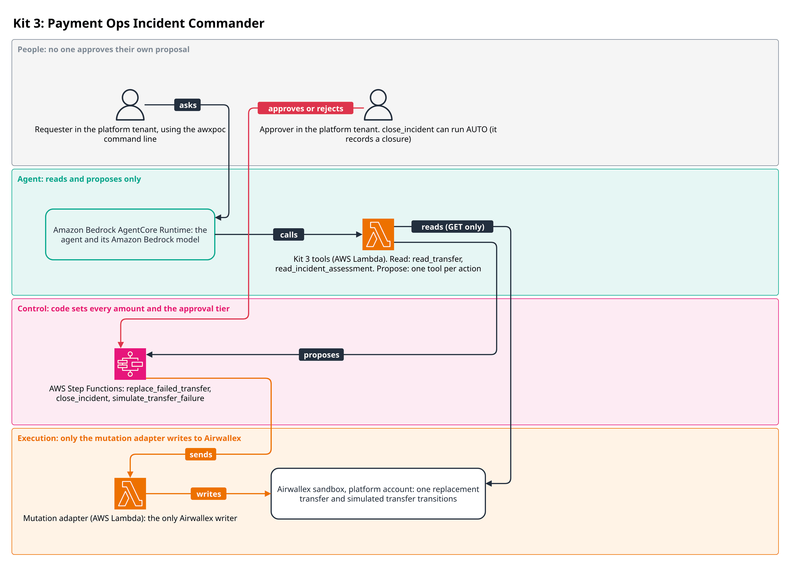
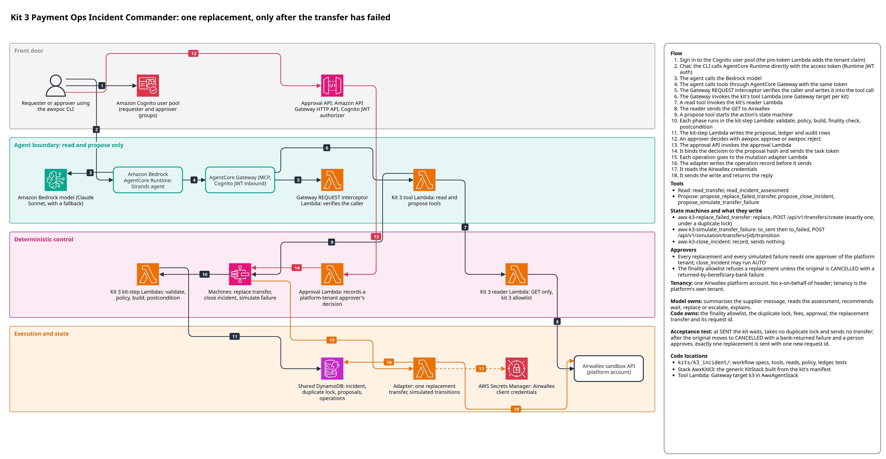

# Kit 3: Payment Ops Incident Commander

A supplier says a payment never arrived. An operations team has to work out what happened to
the transfer and decide whether to wait, re-pay or hand it to a person, without ever paying the
same supplier twice. In this kit the agent reads the transfer, explains its state and recommends
WAIT, REPLACE or ESCALATE. Deterministic code decides whether a replacement may exist at all,
copies every amount from Airwallex's own record, and makes sure one failed transfer gets at most
one replacement. The package is pure Python on `awx_common`: no network, no AWS and no model
calls. [DESIGN.md](DESIGN.md) holds the detailed design notes.



A requester in the platform tenant asks the agent about a missing payment. The agent reads the
transfer and the incident assessment and proposes a replacement, a closure or a simulated
failure. Each proposal starts an AWS Step Functions workflow in which code sets the approval
tier. An approver in the platform tenant decides, except that `close_incident` can run AUTO. The
proposer never approves their own proposal. Only the mutation adapter writes the replacement
transfer and simulated transfer transitions to Airwallex.

The detailed reference architecture follows.



The diagram source is `docs/architecture/k3_incident.drawio`.

## Flow
1. An operator stages the supplier payment that will fail (`send_supplier_transfer`, run
   locally by `scripts/stage_original_transfer.py` through `awx_spine_aws.local_runner` with
   `Origin.OPERATOR`). Its reference carries
   a `-nosettle` marker, so the sandbox driver leaves it in flight at SENT. This is not an agent
   tool and is not deployed.
2. A person tells the agent the supplier has not been paid. The agent calls
   `read_transfer` and `read_incident_assessment`. While the transfer is SENT the assessment is
   WAIT and a replacement proposal is BLOCKED.
3. In the sandbox the agent can propose `propose_simulate_transfer_failure`; once approved, the
   state machine `awx-k3-simulate_transfer_failure` moves the transfer to SENT, then FAILED with
   the chosen failure type. Airwallex reads it back as CANCELLED with a `failure` block. The
   sandbox records the failure type of a simulated bank return as `INCORRECT_ROUTING`, though
   the kit asks for `BENEFICIARY_BANK_RETURNED`; the failure code is 90802 either way, and the
   kit decides on the code.
4. The assessment now returns REPLACE only if the failure code is 90802
   (BENEFICIARY_BANK_RETURNED). The agent proposes `propose_replace_failed_transfer`, naming
   only the original transfer id and an incident reference.
5. The policy re-reads the original, checks the duplicate lock and the wallet balance, and
   puts the replacement's request_id, beneficiary, amount, method, fee and reference in
   `computed`. A person other than the proposer approves it, bound to the proposal hash.
6. `awx-k3-replace_failed_transfer` re-checks everything in its build step, takes the kit-store
   lock, and sends one `POST /api/v1/transfers/create`. The finality poll waits for PAID or
   CANCELLED (in the sandbox, the driver moves it to SENT, then PAID).
7. The postcondition moves the lock from what it reads (LANDED, IN_FLIGHT, RELEASED or
   REPLACEMENT_FAILED) and writes the closure record: the original's failure and the
   replacement's outcome. If the replacement settles later, `propose_close_incident`
   (`awx-k3-close_incident`) records the closure.
8. Once the replacement is PAID, the assessment of the original reads ESCALATE with
   "duplicate lock held". That is the expected end state: the original has had its one
   replacement, so a second one is refused.

## Model and code responsibilities
The model summarises the supplier's message, reads the assessment, recommends an action and
explains it. It can start a replacement only by naming the original transfer and an incident
reference; no tool input carries an amount, an account, a beneficiary or a request_id.

Code owns the rest: the finality allowlist (`finality.py`), the duplicate lock and the attempt
number (`ledger.py`, `policy.py`), every amount and fee (copied from the original's provider
record), the request_ids (`airwallex.py`), the re-check before sending and the closure record
(`closure.py`). The policy is pure and re-runs before any step (runner rule 1), so an approval
turns STALE if the original changes while it waits.

## Actions and tools

| Tool | Kind | Starts | Lowest tier when the agent proposes |
|---|---|---|---|
| `read_transfer` | READ | | |
| `read_incident_assessment` | READ | | |
| `propose_replace_failed_transfer` | PROPOSE | `awx-k3-replace_failed_transfer` | SINGLE |
| `propose_close_incident` | PROPOSE | `awx-k3-close_incident` | AUTO |
| `propose_simulate_transfer_failure` | PROPOSE | `awx-k3-simulate_transfer_failure` | SINGLE |

`send_supplier_transfer` lives in `workflow.STAGING_SPECS`, not in `SPECS`, so it has no
tool and no state machine.

## Approval rules

| Action | Policy tier |
|---|---|
| `replace_failed_transfer` | SINGLE; BLOCKED unless the assessment is REPLACE, the lock and any listed replacement allow a fresh attempt or a resume of the one in flight, the original is copyable and, for a fresh attempt, the wallet covers amount plus fee |
| `close_incident` | AUTO; BLOCKED unless exactly one replacement exists and both dispositions are terminal |
| `simulate_transfer_failure` | AUTO; BLOCKED unless kit 3 created the transfer (`poc-i3-` label) and it is SCHEDULED, PROCESSING or SENT. An agent proposal is raised to SINGLE |
| `send_supplier_transfer` (operator staging) | SINGLE; BLOCKED for any currency but USD, above 10.00, for a beneficiary whose nickname does not start `poc-i3-`, for a `payment_key` already paid, or when funds fall short |

No kit 3 action is DUAL. Kit 3 runs as the platform tenant, so a SINGLE approval comes from a
platform approver who is not the proposer (`awx_common.approvals`). A proposal the model
starts is raised to at least SINGLE, except `close_incident`.

`close_incident` keeps AUTO for agent proposals (`agent_min_tier=RiskTier.AUTO`). It sends no
Airwallex write and moves no money. It writes one kit-store record whose content the policy
derives entirely from two provider reads, the proposal hash covers that record, and a record
that conflicts with an existing one is refused. An injected instruction can at most make the
agent record a closure that is already true.

## Money safety

- Only status CANCELLED with `failure.code` 90802 is replaceable. SENT, FAILED, PAID, an
  unknown status, a bare cancellation and any other code never are.
- The replacement's request_id is keyed on the original transfer and the attempt, never the
  incident, so every path that could re-pay one transfer builds the identical body under the
  identical request_id. Airwallex's deduplication and a `?request_id=` listing both catch it.
- A kit-store lock per original transfer, taken by conditional create before anything is sent
  and owned by the run's proposal_id (M4). An unknown outcome keeps it IN_FLIGHT (M1); a later
  run resumes the same Operation on the same request_id and never mints attempt 2.
- A run that resumes someone else's attempt joins the lock first, and a joined lock is never
  released, because the owner's evidence does not cover the joiner's send.
- Past 6 days from the first send (the margin on Airwallex's deduplication window of about 7
  days) nothing is resent; a person decides.
- Every write step has a reconcile hook (rule 9), and simulation transitions are reconciled by
  reading status, because a transition can answer 500 and still apply.
- The incident closes only with both dispositions recorded; a replacement that also ends
  CANCELLED goes to a person.

See [DESIGN.md](DESIGN.md) for the lock states, request ids, fees and the full refusal rules.

## Infrastructure

The generic `KitStack` builds `AwxKitK3` from `SPECS`; kit 3 writes no CDK and declares no
FUNCTIONS or OPERATOR_COMMANDS. The stack holds:

| Resource | Detail |
|---|---|
| State machines (root only, no children) | `awx-k3-replace_failed_transfer`, `awx-k3-close_incident`, `awx-k3-simulate_transfer_failure`, each with a log group and failed and timed-out alarms |
| Kit-step Lambdas | one per action, handler `awx_spine_aws.handlers.kit_step.handler`, 60 s, 512 MB, no access to the Airwallex secret |

`AwxAgentStack` adds the tool Lambda `K3ToolsHandler` ("AgentCore Gateway tools for k3 (read
and propose only)") and the Gateway target `k3` carrying the tools above. `AwxSpine` adds the
reader `ReaderK3Fn`, which may call only `GET /api/v1/transfers`,
`GET /api/v1/transfers/{id}` and `GET /api/v1/balances/current`. The only writes are
`POST /api/v1/transfers/create` and `POST /api/v1/simulation/transfers/{id}/transition`,
sent by the spine's mutation adapter.

Synth or deploy only this kit, with `REGION` set in the shell
(`export REGION=us-west-2`, or the Region of the deployment being updated):

```
make synth ACCOUNT=111122223333 ALERT_EMAIL=you@example.com KITS=k3 REGION="$REGION"
make deploy ACCOUNT=<12-digit id> ALERT_EMAIL=<address> KITS=k3 REGION="$REGION"
```

A partial deploy (`KITS=k3`) over a full one rebuilds `AwxAgentStack` with kit 3's tools only
and removes every other kit's tools. See [infra/README.md](../../infra/README.md).

## Setting up a deployed kit

Kit 3 needs no tenants-table rows, no operator commands and no `deploy/k3.yaml`: it runs as the
platform tenant. The sandbox platform account needs USD available for the staged payment and
its replacement (1.00 USD each in the live runs).

Before a demo, an operator stages the original locally with the sandbox key in
`~/.config/airwallex-sandbox/credentials.env`:

```
uv run --all-packages python kits/k3_incident/scripts/stage_original_transfer.py
```

The script runs `STAGING_SPECS["send_supplier_transfer"]` through
`awx_spine_aws.local_runner.run_kit_workflow` with `Origin.OPERATOR` (`Origin` lives in
`awx_common.approvals`) and `stage_for_incident: true`, holding `flock /tmp/awx-sandbox.lock`.
Staging is SINGLE, so the script shows the proposal (payee name, bank, account last 4, amount
and fee) and asks the operator to type `yes`; it records that approval under a second identity.
Any answer but `yes` rejects it and nothing is sent. Options:
`--beneficiary-id` (default: the `poc-i3-supplier` beneficiary, which the kit 3 live test
creates), `--amount` (USD, default 1.00, at most 10.00), `--payment-key` and `--yes` (approve
without asking). It prints the transfer id; tell the agent the supplier has not been paid for
that transfer. A re-run is not idempotent, even with the same `--payment-key`: each run mints a
new book and the request_id carries the book, so the same key sends a new transfer. Before the
send the script prints the payment key and the transfer's reference (`poc-i3-<payment key>`
ending `-nosettle`), so after a crash find the transfer by that reference in the sandbox before
running the script again. `tests/test_stage_script.py` runs the script against FakeAirwallex.

The deployed tools then need none of the operator's local records: they read the original from
Airwallex by its id, and the replacement's request_id is keyed on that id. See
[docs/deployment.md](../../docs/deployment.md).

## Tests

All scenario and property tests run through `run_kit_workflow` against `FakeAirwallex`, with
one clock, one operation store and one kit store shared across runs (`tests/k3_fixtures.py`).

| File | Proves |
|---|---|
| `test_scenarios.py` | the required acceptance test `test_required_acceptance_sent_waits_then_failed_replaces_exactly_once`; staging; simulation; faults on the replacement (timeouts, list lag, duplicate delivery, a 500 that applies, a 429 then a crash, refusals, uncertain-send shapes from the real executor); locks, joins and the margin; closure; SWIFT fees; staging guardrails |
| `test_finality.py` | the allowlist and request-id derivation, unit and property tests |
| `test_properties.py` | no sequence of incidents and faults yields two replacements for one original |
| `test_rule0.py` | every build run twice per proposal leaves one send and no stranded lock |
| `test_contract.py` | exports, validation, the closure record, agent floors, reconcile hooks, lock ownership |
| `test_tool_surface.py` | every tool through the real ToolDispatcher: approval binding, tenant isolation, server-owned fields, re-proposals |
| `test_acceptance_live.py` | the live sandbox run, plus fake-only proofs of its cleanup, its `NEEDS_PERSON` guidance and run record |
| `test_stage_script.py` | `scripts/stage_original_transfer.py` against the fake: approval, refusal without one, beneficiary lookup, staging guardrails |
| `test_synth.py` | marker `synth`: the synthesised `AwxKitK3` and kit 3's Gateway target |

The live test is marker `sandbox` and runs only with `AWX_K3_LIVE=1`:

```
AWX_K3_LIVE=1 uv run --all-packages pytest kits/k3_incident/tests/test_acceptance_live.py -m sandbox </dev/null
```

It holds `flock /tmp/awx-sandbox.lock` for the whole run, uses a fresh kit store, reuses (or
creates once) the `poc-i3-supplier` beneficiary, stages 1.00 USD, simulates a bank return and
pays one 1.00 USD replacement. Cleanup runs whatever the outcome: an original still in flight
goes through the kit's failure simulation (a bank return refunds it) and a replacement still in
flight is driven to PAID. Cleanup does not always leave nothing at SENT: a sandbox simulation
can answer with an unknown outcome, and cleanup never retries one, because simulations are not
idempotent. On 8 Oct 2026 the failure simulation answered `OUTCOME_UNKNOWN`, the original stayed
SENT and the sandbox later settled it to PAID, not refunded. When cleanup cannot finish (an
original or replacement still in flight, or an original that ended PAID), the test prints
`NEEDS_PERSON` guidance naming each transfer id and what to check in the sandbox, and fails if
anything is still in flight. It writes a run record, including that guidance, to
`$AWX_K3_SHAPES` when set. See [docs/testing.md](../../docs/testing.md).

## Validation

- Live sandbox, 6 Oct 2026, through the committed `test_acceptance_live.py`: a 1.00 USD
  original went SENT, then FAILED with BENEFICIARY_BANK_RETURNED, and read back CANCELLED with
  failure code 90802 and was refunded; one replacement of 1.00 USD was approved and reached
  PAID; nothing was left at SENT. The sandbox's transfer shapes matched FakeAirwallex.
- Deployed agent, 7 Oct 2026, driven with a script that is not part of this repository. An
  operator staged a 1.00 USD original locally; the agent proposed the failure simulation
  (approved, CANCELLED with 90802), read REPLACE from the assessment, proposed the replacement
  (approved) and it reached PAID. Nothing was left in flight.
- A deployment from a fresh clone into a new account, 8 Oct 2026. The original 1.00 USD
  transfer was staged locally with an approval decision (the command above). Through the
  deployed agent the assessment was WAIT while it was PROCESSING; the simulated failure was
  proposed (SINGLE) and approved, and the transfer read back CANCELLED with failure code 90802;
  the replacement was proposed (SINGLE) and approved and reached PAID for 1.00 USD; a second
  replacement request was refused (ESCALATE, duplicate lock held). The sandbox reported the
  failure type as INCORRECT_ROUTING, not BENEFICIARY_BANK_RETURNED; the code 90802 matched, so
  the kit accepted it. The same day the live test failed once (see the live test above) and
  passed on its second run.
- The same deployment after the fixes in this repository, 8 Oct 2026. The staging script
  (the command above) staged the original. Through the deployed agent, the assessment read the
  original as still in flight, then the failure simulation and the replacement each ran after
  its approval. The flow ended with the original CANCELLED with failure code 90802 and the
  1.00 USD replacement PAID.

Not validated live: the cleanup paths (proved on the fake only), SWIFT fees, attempts after a
refusal, resumes, joins and the 6-day margin, and `propose_close_incident` as a separate step.

## Assumptions and limits

- Only 90802 is replaceable. 91401 and 91402 escalate (no sandbox reproduction, late-credit
  risk). See [DESIGN.md](DESIGN.md#guide-ambiguities).
- PAID is not final in the documented state machine; a PAID original escalates.
- The 6-day margin assumes Airwallex's documented deduplication window of about 7 days.
- No override lets a person accept double-payment risk and replace a non-terminal original.
- Cross-currency originals and originals with an inline beneficiary escalate.
- A replacement a person makes by hand in the Airwallex web app is not seen by any lock.
- Staging trusts the `poc-i3-` nickname prefix as its only payee check; the approver must check
  the shown name and account last 4.
