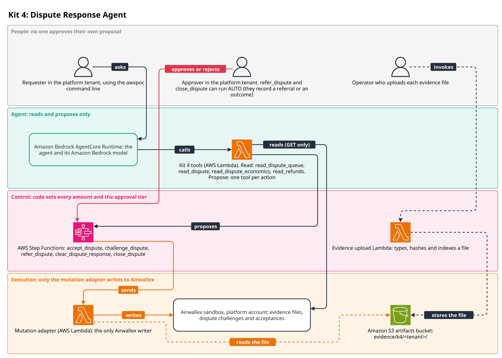
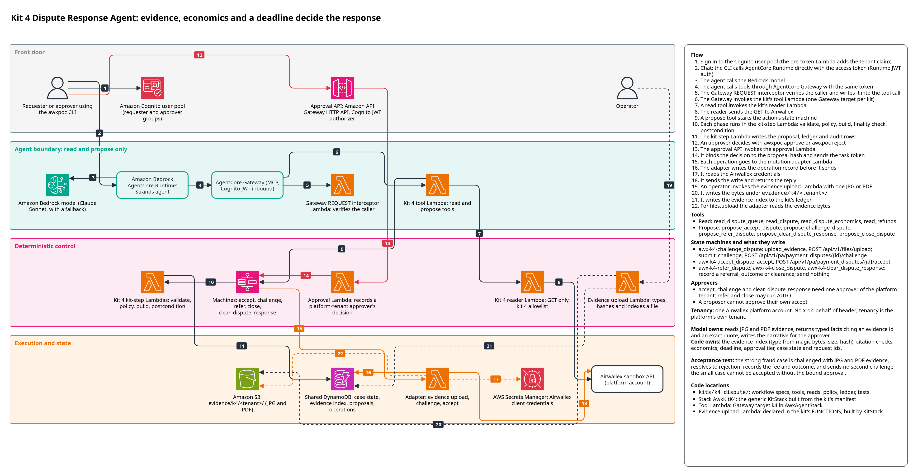

# Kit 4: Dispute Response Agent

A finance operations lead works a chargeback queue. For each dispute someone has to read the
evidence, work out whether contesting is worth the fee and the staff time, check how long is
left before the deadline, and get the right person to sign off before anything irreversible
is sent to Airwallex. This kit does that: the agent reads JPG and PDF evidence and proposes an
accept, a challenge or a referral, and deterministic code decides the economics, the deadline,
whether the evidence meets the minimum, and who must approve.



An operator uploads each evidence file through an AWS Lambda function that stores it in Amazon
S3. A requester in the platform tenant asks the agent, which reads the dispute queue, disputes,
economics and refunds and proposes a response. Code in AWS Step Functions decides the economics,
the deadline and the approval tier. An approver in the platform tenant decides, except that
`refer_dispute` and `close_dispute` can run AUTO. The proposer never approves their own
proposal. Only the mutation adapter writes to Airwallex: it reads the evidence file from Amazon
S3, uploads it and sends a challenge or an acceptance.

The detailed reference architecture follows, and [DESIGN.md](DESIGN.md) holds the design notes.



The diagram source is `docs/architecture/k4_dispute.drawio`.

## Flow
1. An operator files each evidence file for a dispute through the kit's evidence upload
   Lambda (`evidence_upload`). It types the file from its bytes, hashes it, writes a
   code-owned index entry to the kit store and the bytes to the evidence bucket.
2. The agent lists the queue (`read_dispute_queue`), reads a dispute (`read_dispute`,
   `read_refunds`) and extracts typed facts from the evidence, each citing an `evidence_id`
   and an exact quote.
3. The agent calls `read_dispute_economics` with those facts. Code checks every citation,
   derives the evidence strength band, computes the cost of accepting and of contesting, the
   recommendation and the deadline.
4. The agent proposes one action: `propose_challenge_dispute`, `propose_accept_dispute`,
   `propose_refer_dispute` or, once Airwallex reaches an outcome, `propose_close_dispute`.
5. Policy sets the risk tier and the approval binds to the proposal hash (intent plus every
   computed value). A different person approves it; a requester cannot approve their own
   proposal.
6. The approved run starts its state machine (`awx-k4-challenge_dispute`,
   `awx-k4-accept_dispute`, `awx-k4-refer_dispute` or `awx-k4-close_dispute`). Each build
   re-reads the dispute and refuses a stale write: a changed amount, stage or policy version,
   or a deadline that passed while approval was pending.
7. A challenge uploads each evidence file (`files.upload`), then submits the challenge with
   `supporting_documents`. An accept is one call. Both carry a fixed `request_id` per dispute,
   stage and attempt.
8. The postcondition reads the dispute back. A response the dispute shows is LANDED and the
   dispute lock is released; anything uncertain stays IN_FLIGHT with the lock held until a
   person reconciles it (`propose_clear_dispute_response`, `awx-k4-clear_dispute_response`).

## Model and code responsibilities
| Model | Code |
|---|---|
| Reads the evidence and returns typed facts (`evidence.FactKind`), each citing an `evidence_id` and an exact quote | Owns the evidence index: content type from magic bytes (PNG refused), size, SHA-256, extracted text and instruction markers |
| Writes a narrative for the approver | Verifies every citation against the pack and the extracted text, and drops facts that fail |
| Names evidence only by `evidence_id` | Derives the strength band, checks the minimum evidence, computes economics and the deadline |
| Chooses which action to propose | Sets the risk tier, chooses every `request_id`, builds every operation and re-reads the dispute before each write |

The model never supplies an amount, a file id, a `request_id` or a deadline. A prompt
injected into a document can at most make the model propose; it cannot lower a tier or move
money (see [DESIGN.md](DESIGN.md#prompt-injection-fixture)).

## Actions and tools

| Tool | Kind | Starts | Lowest tier when the agent proposes |
|---|---|---|---|
| `read_dispute_queue` | READ | - | - |
| `read_dispute` | READ | - | - |
| `read_dispute_economics` | READ | - | - |
| `read_refunds` | READ | - | - |
| `propose_accept_dispute` | PROPOSE | `awx-k4-accept_dispute` | SINGLE |
| `propose_challenge_dispute` | PROPOSE | `awx-k4-challenge_dispute` | SINGLE |
| `propose_refer_dispute` | PROPOSE | `awx-k4-refer_dispute` | AUTO |
| `propose_close_dispute` | PROPOSE | `awx-k4-close_dispute` | AUTO |
| `propose_clear_dispute_response` | PROPOSE | `awx-k4-clear_dispute_response` | SINGLE |

The package exports these as `SPECS` (`workflow.py`), `TOOLS` (`tools.py`) and `READS`
(`reads.py`, one pure function per read tool).

## Approval rules

| Action | AUTO | SINGLE | DUAL | BLOCKED |
|---|---|---|---|---|
| accept | never | amount below the dual-approval threshold | amount at or above it | not respondable, act-by passed, amount differs from Airwallex, a refund exists, `LOW_VALUE` while contesting could still pay; full list in [DESIGN.md](DESIGN.md#approval-matrix) |
| challenge | never | economics say CONTEST, amount below the threshold | amount at or above the threshold, or economics say REFER | economics say ACCEPT, evidence too weak or missing, a prior challenge, act-by passed; full list in [DESIGN.md](DESIGN.md#approval-matrix) |
| refer | always (moves no money) | - | - | - |
| close | provider status terminal and the typed reason fits it | - | - | otherwise |
| clear | never | an empty fresh read-back after the clear bound | - | anything undetermined |

The dual-approval threshold is 1,000.00 AUD or 750.00 USD by default (`config.py`). Kit 4 runs
as the platform tenant, so platform approvers decide (`ApproverScope.OWN_TENANT`), and the
approver must be a different person from the requester. A proposal the model starts is raised to
at least SINGLE, except `refer_dispute` and `close_dispute`, which only record a decision and
send nothing to Airwallex. The full matrix, including every BLOCKED reason, is in
[DESIGN.md](DESIGN.md#approval-matrix).

## Money safety

- Accept and challenge are irreversible, so neither is ever AUTO, and each needs an approval
  bound to the exact intent and computed values.
- Every accept and challenge carries one `request_id` per dispute, stage and attempt
  (`accept:<stage>`, `challenge:<stage>[:<n>]`), in the body and on the operation.
- A dispute lock, owned by the run's `proposal_id`, stops two runs responding to one dispute.
  Only a definitive outcome releases it (rules M1 and M4).
- The dispute endpoints do not deduplicate, so the kit never resends a response. After an
  unknown outcome the executor reconciles by reading the dispute; if it cannot prove the
  outcome, the response stays IN_FLIGHT and a person decides before the deadline.
- A person clears a stuck response only after a fresh empty read-back, once the original run
  is finished and the clear bound (15 minutes) has passed. The cleared attempt is still
  watched, so a late landing blocks a second response.
- The kit never sends a second challenge, and an accept with a live refund on the same
  payment is BLOCKED so money is not returned twice.
- Dispute fees and handling costs are modelled and kept apart from money Airwallex moved.

Detail: [DESIGN.md](DESIGN.md).

## Infrastructure

`AwxKitK4` (built by the generic `KitStack` from the kit's manifest) deploys:

| Resource | Details |
|---|---|
| State machines | `awx-k4-accept_dispute`, `awx-k4-challenge_dispute`, `awx-k4-refer_dispute`, `awx-k4-close_dispute`, `awx-k4-clear_dispute_response`; each with its log group and failed and timed-out alarms. No child state machines. |
| Kit-step Lambdas | One per action (60 s, 512 MB), running the deterministic workflow phases with no Airwallex secret |
| Declared function | `evidence_upload` (`awx_k4_dispute.upload.handler`, 60 s, 512 MB). Grants: `s3:PutObject` under `evidence/k4/*` in the spine's artifacts bucket, and the kit store (DynamoDB items with leading key `k4#*` in the ledger table), plus the spine key for both. Its name is the stack output `FnEvidenceUploadName`. |

`AwxAgentStack` adds the kit's tool Lambda (`AgentCore Gateway tools for k4 (read and propose
only)`) and the AgentCore Gateway target `k4`. `AwxSpine` holds the kit's
reader (`ReaderK4Fn`), which may call only these GET paths for kit 4:

- `/api/v1/pa/payment_disputes` and `/api/v1/pa/payment_disputes/{id}`
- `/api/v1/pa/refunds`
- `/api/v1/pa/payment_intents/{id}`

To synth or deploy only this kit, with `REGION` set to `us-west-2` or the Region of the
deployment being updated:

```
export REGION=us-west-2
make synth ACCOUNT=111122223333 ALERT_EMAIL=you@example.com KITS=k4 REGION="$REGION"
make deploy ACCOUNT=<12-digit id> ALERT_EMAIL=<address> KITS=k4 REGION="$REGION"
```

A partial deploy over a full one removes the other kits' tools from the agent's Gateway.

## Setting up a deployed kit

Kit 4 has no operator commands, no `deploy/k4.yaml` and no tenants-table rows: it runs as the
platform tenant, so the `demo-platform-requester` and `demo-platform-approver` users are all it
needs (see [docs/deployment.md](../../docs/deployment.md)). Before the agent can work a dispute,
file its evidence by invoking the `evidence_upload` function directly:

```
{"tenant_id": "platform", "dispute_id": "...", "evidence_id": "ev_signature",
 "file_name": "signature.jpg", "kind": "DELIVERY_PROOF", "content_base64": "...",
 "text": "optional extracted text"}
```

`tenant_id` must be `platform`. Files are capped at 4.4 MB. Disputes cannot be staged in the
sandbox until Airwallex enables online payments (payment acceptance) on the account.

## Tests

Offline (`make check`, or `make test` for the tests only), everything through
`awx_spine_aws.local_runner.run_kit_workflow` against
`FakeAirwallex(online_payments_enabled=True)` where a runner is involved:

| Topic | Files |
|---|---|
| Economics, deadlines, evidence, intents and ledger, approval matrix | `test_economics.py`, `test_deadlines.py`, `test_evidence.py`, `test_intents_ledger.py`, `test_policy_matrix.py` |
| Provider body shapes, status vocabulary, reconcile hook | `test_provider_bodies.py` |
| Policy guards (purity, evidence index, tenant scope, agent floor, book id) | `test_policy_guards.py` |
| Acceptance scenarios, faults, the lock, deadlines, prompt injection | `test_scenarios.py` |
| Uncertain sends never resent | `test_uncertain_outcomes.py` |
| Stage changes and lost step results | `test_stage_changes.py` |
| Every build run twice (rule 0) | `test_rebuilds.py` |
| Clearing a stuck response | `test_clear.py` |
| Another run's response, attempt numbering | `test_other_runs.py` |
| Evidence upload handler | `test_upload.py` |
| Every tool through the real ToolDispatcher | `test_tool_surface.py` |
| SPECS, TOOLS and READS tables | `test_contract_k4.py` |

The required acceptance tests are
`test_scenarios.py::test_required_acceptance_strong_fraud_challenged_rejected_and_closed` and
`::test_required_acceptance_small_case_cannot_be_accepted_without_bound_approval`.

Synth (`make synth-test`, marker `synth`): `test_synth.py` checks the declared upload function,
its handler, environment and exact grants in the synthesised `AwxKitK4` template.

Sandbox (`make sandbox-test`, marker `sandbox`): `test_acceptance_sandbox.py` runs the whole
acceptance scenario with `poc-i4-` labels, a fresh book id and `flock /tmp/awx-sandbox.lock`.
Its `fake` variant runs on FakeAirwallex; its `live` variant is skipped until Airwallex enables
online payments on the sandbox account, and no live port is wired for it yet.

## Validation

Kit 4 is validated offline only. Against the real Airwallex sandbox,
`POST /api/v1/pa/payment_intents/{id}/confirm` with the test card returns 400 "This account is
not enabled for native API access", and a dispute can only be staged on a paid intent. So no
dispute was staged, accepted or challenged live, and no deployed agent run exercised kit 4.
Not validated live: the per-stage response record shape, the `product_type` value, the dispute
read lag that sets the clear bound, and whether Airwallex refuses a second response.

## Assumptions and limits

- The kit never sends a second challenge; after a rejection it accepts or closes as LOST
  ([DESIGN.md](DESIGN.md#guide-ambiguities)).
- The dispute fee is a cost of contesting only (`fee_on_accept=False`).
- PNG evidence is refused, as the guide says, although Airwallex accepts it.
- The model's narrative goes to the approver and the case, not to Airwallex.
- Win probabilities, fees, handling costs, thresholds and the evidence size limit are
  assumptions in `config.py`.
- `product_type` (`PHYSICAL_GOODS`), the provider accept reason strings and the per-stage
  response details come from API-reference evidence and FakeAirwallex, not a live dispute.
- A definitive 400 on the first challenge cannot be corrected through the kit under the same
  key: confirm `product_type` before any live demo.
