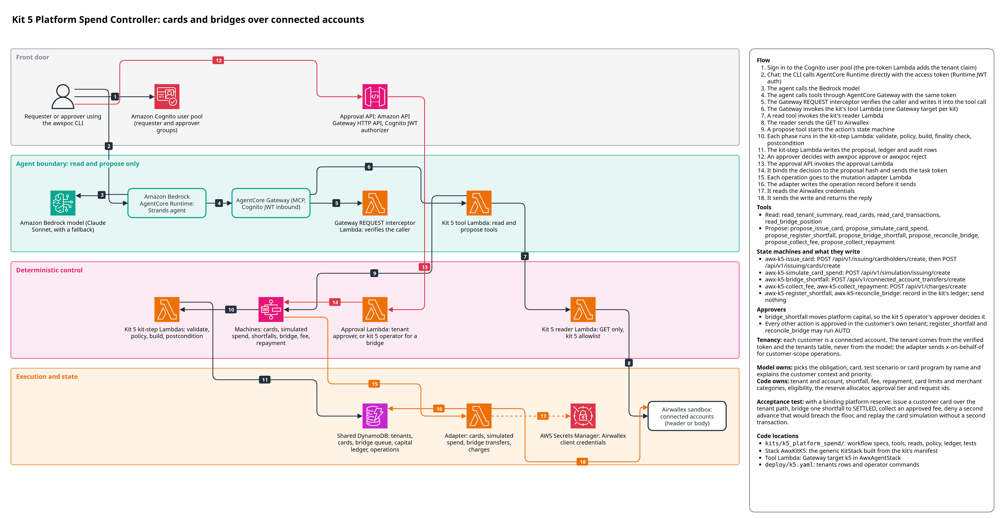

# Kit 5: Platform Spend Controller

A platform issues corporate cards to small businesses, each a connected account with its own
wallet. When a customer's deposit is late and a payment is due today, the platform may bridge
the shortfall from its own capital and charge it back when the deposit lands. Bridge capital is
scarce and a reserve floor binds, so this kit rations it in code: a capital ledger, a
deterministic allocator, card issuing under platform-defined programs, fee and repayment
charges, and server-side tenant binding so one customer can never reach another's account.



The diagram source is `docs/architecture/k5_platform_spend.drawio`.

## Flow
1. An operator seeds the platform setup (bridge policy, card programs, tenant map,
   obligations, fees) and funds the capital ledger with the kit's operator commands.
2. A customer user signs in; the agent calls read tools for that tenant only
   (`read_tenant_summary`, `read_cards`, `read_card_transactions`, `read_bridge_position`).
3. `propose_register_shortfall` starts `awx-k5-register_shortfall`. Code computes the
   shortfall from the tenant's own wallet balance and puts it in today's bridge queue. Nothing
   is sent to Airwallex.
4. `propose_bridge_shortfall` starts `awx-k5-bridge_shortfall`. The policy checks eligibility,
   ranks the request against the live queue and funds it only if it fits above the reserve
   floor on both the ledger and the platform wallet. The kit 5 operator approves (two
   approvers for a large bridge or a late repayer).
5. The bridge build places a hold in the ledger and sends one
   `connected_account_transfers/create` from the platform wallet to the customer. The run polls
   the transfer by `?request_id=` until SETTLED; only then does the hold become an advance and
   a receivable.
6. `awx-k5-reconcile_bridge` records a definitive outcome (SETTLED or FAILED) for a bridge whose
   run ended without one.
7. `awx-k5-collect_fee` and `awx-k5-collect_repayment` pull the monthly fee and the advance back
   with `charges/create`, each approved by the tenant's own approver, each polled to SETTLED.
8. `awx-k5-issue_card` creates a cardholder and a virtual card with the program's limits and
   merchant categories; `awx-k5-simulate_card_spend` runs one sandbox card transaction per
   scenario and reconciles it from the card's transaction list.

## Model and code responsibilities
The model picks references and writes words: which obligation, which card, which test
scenario, which card program by name, and a `rationale` for the approver.

Code owns everything else: the tenant and its connected account (from the verified sign-in
claim and the tenant map), the shortfall, the fee, the repayment, card limits and merchant
categories, the cardholder email, eligibility, the priority order, the allocator, the approval
tier and every request_id. No tool input carries a server-owned field, and no read tool
returns an `acct_` value.

## Actions and tools

| Tool | Kind | Starts | Lowest tier when the agent proposes |
|---|---|---|---|
| `read_tenant_summary` | READ | - | - |
| `read_cards` | READ | - | - |
| `read_card_transactions` | READ | - | - |
| `read_bridge_position` | READ | - | - |
| `propose_register_shortfall` | PROPOSE | `awx-k5-register_shortfall` | AUTO |
| `propose_bridge_shortfall` | PROPOSE | `awx-k5-bridge_shortfall` | SINGLE |
| `propose_reconcile_bridge` | PROPOSE | `awx-k5-reconcile_bridge` | AUTO |
| `propose_collect_fee` | PROPOSE | `awx-k5-collect_fee` | SINGLE |
| `propose_collect_repayment` | PROPOSE | `awx-k5-collect_repayment` | SINGLE |
| `propose_issue_card` | PROPOSE | `awx-k5-issue_card` | SINGLE |
| `propose_simulate_card_spend` | PROPOSE | `awx-k5-simulate_card_spend` | SINGLE |

`register_shortfall` and `reconcile_bridge` lower the agent floor to AUTO because neither sends
anything to Airwallex or moves money; [DESIGN.md](DESIGN.md#approval-rules) gives the reasoning.

## Approval rules

| Action | AUTO | SINGLE | DUAL | BLOCKED |
|---|---|---|---|---|
| `register_shortfall` | always | - | - | no obligation, no shortfall, ineligible, already bridged |
| `reconcile_bridge` | definitive provider outcome | - | - | nothing in flight; pending, SUSPENDED, absent or mismatched |
| `issue_card` | - | always | - | tenant inactive, unknown program, already issued for this ref |
| `simulate_card_spend` | SCHEDULE origin only | model-started | - | scenario already run, card not issued by this kit, amount over the cap |
| `bridge_shortfall` | - | at or below `high_risk_bridge`, clean record | above `high_risk_bridge`, or any late repayment | no shortfall, ineligible, in flight, allocator denial |
| `collect_fee` | - | always | - | no schedule, future period, already collected, balance below fee |
| `collect_repayment` | - | always | - | nothing outstanding, deposit not landed |

`bridge_shortfall` is approved by the kit 5 operator (an approver whose tenant claim is
`k5:operator`), because the money comes from the platform's capital. Every other action is
approved by the requester's own tenant. An approval binds to the proposal hash, so a changed
balance or consumed headroom fails the run as stale before anything is sent.

## Money safety

- Every request_id derives from a business key (obligation, fee period, advance, cardholder,
  card, scenario) plus a book id, so a re-proposal reuses the same request_id and a reset store
  can never adopt an earlier run's objects.
- A bridge is a hold until the provider reads SETTLED. The hold is placed in one versioned
  ledger write that checks the reserve floor against both the ledger and the platform wallet,
  so two bridges racing for the last room cannot both be held.
- After an unknown outcome the hold (bridge) or the attempt (charge) stays on the same
  request_id; a later refusal is not treated as definitive. A new request_id comes only after a
  confirmed failure.
- Past a 6-day margin inside Airwallex's 7-day request_id deduplication window, nothing is
  resent: the proposal goes to a person.
- Card simulation ignores request_id, so an unknown outcome is never resent; each scenario runs
  once.
- The ledger reconciles against the provider's settled movements.

Detail: [DESIGN.md](DESIGN.md).

## Infrastructure

`AwxKitK5` (the generic `KitStack` built from the kit's manifest) deploys:

- root state machines, one per action: `awx-k5-register_shortfall`,
  `awx-k5-bridge_shortfall`, `awx-k5-reconcile_bridge`, `awx-k5-collect_fee`,
  `awx-k5-collect_repayment`, `awx-k5-issue_card`, `awx-k5-simulate_card_spend`. There are no
  child state machines.
- one kit-step Lambda per action (`awx_spine_aws.handlers.kit_step.handler`, no Airwallex
  secret), and failed and timed-out execution alarms per machine. Kit 5 declares no functions
  of its own.

`AwxAgentStack` adds the `K5ToolsHandler` tool Lambda and the `AgentGatewayK5Target` Gateway
target (`k5`, "Platform Spend Controller read and propose tools"). The spine's `ReaderK5Fn` may
call these GET paths:

| Scope | Paths |
|---|---|
| platform (no header) | `/api/v1/balances/current`, `/api/v1/connected_account_transfers[/<id>]`, `/api/v1/charges[/<id>]` |
| tenant (`x-on-behalf-of`) | `/api/v1/balances/current`, `/api/v1/issuing/cardholders[/<id>]`, `/api/v1/issuing/cards[/<id>]`, `/api/v1/issuing/transactions` |

Synth or deploy only this kit:

```
make synth ACCOUNT=111122223333 ALERT_EMAIL=you@example.com KITS=k5
```

A partial deploy (`make deploy ... KITS=k5`) over a full one removes the other kits' tools from
the agent stack. See [infra/README.md](../../infra/README.md).

## Setting up a deployed kit

Until the setup is seeded, every read tool answers "kit 5 is not configured yet" and every
proposal is BLOCKED; nothing reaches Airwallex.

1. Create three connected accounts on the sandbox platform account with nicknames
   `poc-i5-t-alpha`, `poc-i5-t-bravo`, `poc-i5-t-charlie`. The seed command refuses any account
   that is missing, not ACTIVE, or not labelled `poc-i5-`.
2. Pass the variables listed at the top of `deploy/k5.yaml` (`K5_ACCT_ALPHA`, `K5_ACCT_BRAVO`,
   `K5_ACCT_CHARLIE`, `K5_DUE_ON`, `K5_EXPECTED_DEPOSIT_ON`) with `--var`, first to `plan`, then
   to `apply`:

   ```
   uv run --all-packages awx-deploy plan deploy/k5.yaml \
     --var K5_ACCT_ALPHA=acct_... --var K5_ACCT_BRAVO=acct_... --var K5_ACCT_CHARLIE=acct_... \
     --var K5_DUE_ON=YYYY-MM-DD --var K5_EXPECTED_DEPOSIT_ON=YYYY-MM-DD
   uv run --all-packages awx-deploy --profile <profile> apply deploy/k5.yaml \
     --var K5_ACCT_ALPHA=acct_... --var K5_ACCT_BRAVO=acct_... --var K5_ACCT_CHARLIE=acct_... \
     --var K5_DUE_ON=YYYY-MM-DD --var K5_EXPECTED_DEPOSIT_ON=YYYY-MM-DD
   ```

   `apply` writes the tenants rows (kit `k5`, role `customer`) and runs the operator commands
   `seed_platform_setup` and `fund_capital`.
3. Deposit the funded capital into the platform wallet with a sandbox deposit, under
   `flock /tmp/awx-sandbox.lock`, so the wallet-room check and the ledger agree.
4. Create demo users: a requester and an approver per customer tenant, and an approver with
   tenant claim `k5:operator` for bridges.

The operator command runbook (replace rules, refusals, the shared-partition risk) is in
[DESIGN.md](DESIGN.md#operator-commands). See [docs/deployment.md](../../docs/deployment.md).

## Tests

Offline (`make check`, or `pytest kits/k5_platform_spend/tests`), every scenario through the
real runner (`awx_spine_aws.local_runner`) against `FakeAirwallex`:

| File | Proves |
|---|---|
| `test_scenarios.py` | the acceptance scenario, cards and simulations, bridges, injected faults on bridges and charges, the deduplication margin, refused resends, the real executor's uncertain shapes |
| `test_money_rules.py` | allocator and ledger properties (hypothesis), invariants, holds, the reserve floor under interleaved writes |
| `test_reserve_race.py` | two concurrent bridges never breach the wallet floor (in memory and DynamoDB under moto) |
| `test_rule0.py` | every build run twice per proposal sends once and strands nothing |
| `test_contract_and_tenancy.py` | tenant binding, request ids, allowlists, reconcile hooks, validation |
| `test_operator_commands.py` | seeding from empty stores, replace refusals, tenants-row disagreement |
| `test_tool_surface.py` | every tool through the real dispatcher, reader and propose path |

`test_synth.py` (marker `synth`, `make synth-test`) synthesises the kit through the generic
`KitStack`. `test_acceptance_sandbox` (marker `sandbox`) runs the acceptance scenario against
`FakeAirwallex`; no live wiring is committed, and with `AWX_K5_LIVE` set it skips. See
[docs/testing.md](../../docs/testing.md).

## Validation

- Live sandbox, 6 October 2026 (UTC): the acceptance scenario ran under the sandbox lock,
  driven by a copy of the scenario that is not part of this repository. The operator commands
  `seed_platform_setup` and `fund_capital` passed, including the account checks on the customer
  accounts. A card was issued. A
  100.01 USD payment was declined over the limit, and a 10.00 USD payment in a blocked merchant
  category was declined. A 340 USD bridge and a 25 USD fee settled. A second customer's bridge
  was refused at the reserve floor. The ledger reconciled with the provider and no holds were
  left.
- One 40 USD card authorisation on a connected account stayed pending: this sandbox key cannot
  capture or reverse it ("Admin permissions required"), and the kit reported it as still
  pending. The replay check was not run live.
- Deployed agent, 7 October 2026: asked as the platform login (no kit 5 customer login
  exists), kit 5 refused ("kit k5 needs a tenant_id claim") and the agent reported the refusal.
- Not validated live: a bridge or charge through the deployed stack, an operator-approved
  bridge, repayment collection, and reconcile after a provider FAILED or SUSPENDED (the sandbox
  cannot provoke them).

## Assumptions and limits

- Connected accounts and platform payments must be enabled on the sandbox account (an account
  setting, not code).
- One currency per platform; one open advance per tenant; repayment collects the whole
  receivable or nothing.
- "Due today" is the UTC date of the policy's clock.
- The platform wallet is shared with other kits: a debit by another kit between kit 5's wallet
  read and its hold can take the wallet below the floor. See
  [DESIGN.md](DESIGN.md#reserve-floor-under-concurrency).
- On a connected account, an approved single-phase card simulation stays PENDING with funds
  reserved; the fake approves it at once.
- Further readings of the guide and the API reference:
  [DESIGN.md](DESIGN.md#guide-and-api-assumptions).
