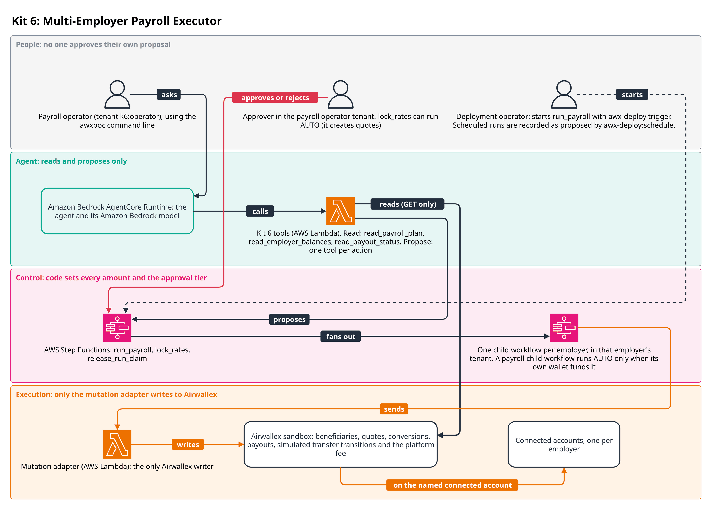
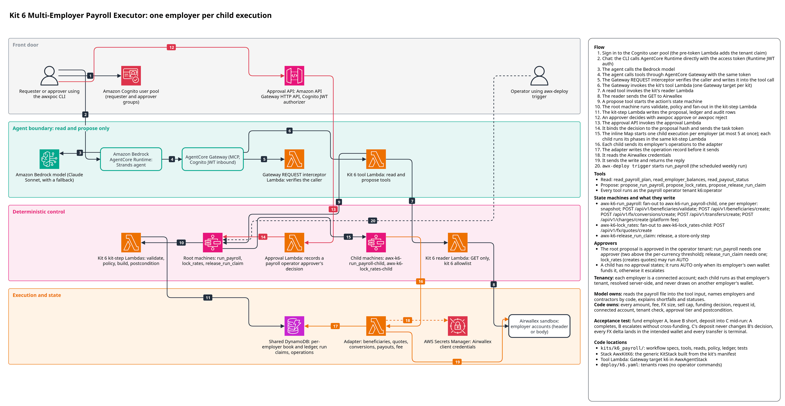

# Kit 6: Multi-Employer Payroll Executor

A platform runs weekly contractor payroll for several small employers, each a connected
account on Airwallex. For every employer it must price the payroll including fees, convert
currencies on that employer's behalf, create contractor beneficiaries, pay, and collect its own
fee. One employer comes up short while another employer's deposit lands mid-run in a different
wallet. This kit prices and funds every employer from its own wallet only: a short employer is
blocked and escalated to a person, never funded from another employer, and the others are
paid.



The payroll operator (tenant `k6:operator`) asks the agent to run a pay period, or a deployment
operator starts `run_payroll` with `awx-deploy trigger`. The root AWS Step Functions workflow
starts one child workflow per employer in that employer's tenant. A payroll child workflow runs
AUTO only when its own wallet funds it. An approver in the payroll operator tenant decides the
root proposal, and `lock_rates` can run AUTO. The proposer never approves their own proposal.
Only the child workflows write to Airwallex. They write beneficiaries, quotes, conversions,
payouts, simulated transfer transitions and the platform fee through the mutation adapter.

The detailed reference architecture follows, and [DESIGN.md](DESIGN.md) holds the design notes.



The diagram source is `docs/architecture/k6_payroll.drawio`.

## Flow
1. A person asks the agent to run a pay period's payroll; the model copies the payroll file
   into the tool input, naming employers and contractors by platform code. The format is under
   [Payroll input](#payroll-input).
2. `propose_lock_rates` starts `awx-k6-lock_rates` (AUTO, no approval). One child
   (`awx-k6-lock_rates-child`) per employer that pays in another currency takes a foreign
   exchange (FX) quote on that employer's account and stores it as the rate lock.
3. `propose_run_payroll` starts `awx-k6-run_payroll`. The parent reads nothing: it prices
   every employer from the input and the stored locks and lists one child intent per employer
   in its hashed `computed`. A person approves the whole batch (SINGLE, or DUAL for a large
   payroll).
4. The parent fans out one child (`awx-k6-run_payroll-child`) per employer, under that
   employer's own tenant `k6:employer:<code>`. The child policy reads only that employer's
   wallet: AUTO when it covers what is left of the period, BLOCKED otherwise.
5. A funded child snapshots opening balances and deposits, takes a run claim for the employer
   and period, creates missing beneficiaries and converts each payout currency at the approved
   locked quote.
6. It checks the wallet covers every payout plus its SWIFT (international wire) fee, then sends
   one transfer per contractor and drives each to PAID (in the sandbox, by simulating the
   transition).
7. Once every payout is PAID it charges the platform fee to the employer.
8. The postcondition reads every object back and checks that each balance moved by exactly
   what this run did, in this employer's wallet, then releases the run claim.
9. If a run dies before its postcondition, `propose_release_run_claim` starts
   `awx-k6-release_run_claim` so a person can release the claim once the dead run can send
   nothing more.

## Model and code responsibilities
| Model | Code |
|---|---|
| Reads the payroll file into the tool input, names employers and contractors by platform code, explains shortfalls and statuses | Every amount, fee, FX size, sell cap, funding decision, request_id, connected account (resolved server-side from the employer code), tenant check, approval tier and postcondition |

The model never chooses an account, an amount or a request_id; the tools refuse such fields.

## Payroll input

`propose_lock_rates` and `propose_run_payroll` take the same input, one pay period for one or
more employers. [examples/payroll-2026-W41.json](examples/payroll-2026-W41.json) is a sample
with every supported corridor; paste it into the chat with the request ("lock rates and run
this payroll"). The agent has no tool that lists employers, so name the employer codes in
the request when you write your own payroll.

| Field | Value |
|---|---|
| `pay_period` | an ISO (International Organization for Standardization) week, `YYYY-Www`, such as `2026-W41` |
| `employers[].employer` | the employer's platform code: `a`, `b` or `c` in `deploy/k6.yaml` (tenants `k6:employer:a` and so on) |
| `employers[].funding_currency` | the currency of the employer's wallet that pays, `USD` in the demo |
| `employers[].contractors[]` | 1 to 50 contractors, each listed once per employer |
| `contractor` | the contractor's code: lower-case letters, digits and `-`, up to 24 characters |
| `first_name`, `last_name` | the contractor's name, up to 60 characters each |
| `amount` | `{"amount": "25.00", "currency": "USD"}`; the amount is a decimal string |
| `transfer_method` | `LOCAL` or `SWIFT`, always set explicitly |
| `address` | `street_address`, `city`, `postcode`, `country_code`; a US address also needs `state` as an ISO code such as `US-TX` |
| `bank` | the fields of the corridor, below |

Only these corridors (country, currency, method) are accepted:

| Corridor | `bank` fields |
|---|---|
| US, USD, LOCAL | `account_name`, `account_number`, `routing_number`, `category` (`Checking` or `Savings`, exact casing) |
| GB, GBP, LOCAL | `account_name`, `account_number`, `sort_code`, `bank_name` |
| DE, EUR, SWIFT | `account_name`, `iban`, `swift_code` |

Unknown fields are refused. The input carries no account id, total, fee or request_id: code
prices the payroll and resolves each employer's account from its tenants row.

## Actions and tools

| Tool | Kind | Starts | Lowest tier when the agent proposes |
|---|---|---|---|
| `propose_run_payroll` | PROPOSE | `awx-k6-run_payroll` | SINGLE |
| `propose_lock_rates` | PROPOSE | `awx-k6-lock_rates` | AUTO |
| `propose_release_run_claim` | PROPOSE | `awx-k6-release_run_claim` | SINGLE |
| `read_payroll_plan` | READ | | |
| `read_employer_balances` | READ | | |
| `read_payout_status` | READ | | |

Every tool runs as the payroll operator tenant `k6:operator`; any other tenant is refused.

## Approval rules

| Where | Condition | Tier |
|---|---|---|
| payroll parent | every employer has a pricing blocker | BLOCKED |
| payroll parent | one employer's need in one currency reaches USD 10,000, AUD 15,000, GBP 8,000 or EUR 9,000, or is in any other currency | DUAL |
| payroll parent | otherwise | SINGLE |
| employer child | shortfall, no usable rate lock, another run of the period in flight, money in flight past the deduplication margin, or a pricing blocker | BLOCKED (escalate) |
| employer child | funded from its own wallet | AUTO |
| rate lock | always (a quote moves no money) | AUTO |
| claim release | the root payroll run is terminal | SINGLE; BLOCKED while it runs or cannot be found |

The payroll parent is never AUTO, so a person approves every batch. `lock_rates` is the only
kit 6 action whose spec lowers the agent floor to AUTO: it creates quotes and moves no money.
Root proposals run as `k6:operator` and use `ApproverScope.OWN_TENANT`, so the kit's operator
approvers decide them. The full table and its edge cases are in
[DESIGN.md](DESIGN.md#approval-tiers).

## Money safety

- Request ids derive from a random book id minted on first use plus employer, contractor, pay
  period and attempt, so a rerun re-presents the same ids and never pays twice, and a second
  demo run never adopts the first run's objects ([request ids](DESIGN.md#request-ids)).
- Only a definitive failure (a first send refused at create, or a transfer that reads
  CANCELLED) advances to a new attempt. An unknown outcome stays on its request_id and is
  re-emitted unchanged; past the 6-day margin a person decides (rule M1).
- The approval binds each conversion's exact locked quote and sell amount (rule M3); a
  re-emission that differs is refused with nothing sent.
- A run claim allows one run per employer and pay period at a time; its owner releases it on
  every path its postcondition reaches ([run claims](DESIGN.md#run-claims)).
- No payout leaves unless the employer's wallet covers every payout still to send plus fees.
  If one is still refused mid-run, the sent payouts reach a terminal status and the employer is
  flagged PART-PAID (some payouts sent, the rest not) for a person.
- An object found under a kit request_id that does not match the kit's operation is never
  adopted: a foreign transfer cannot read as a paid payout or unlock the fee.
- The platform fee is charged only after every payout of that employer is PAID.

## Infrastructure

The generic `KitStack` builds `AwxKitK6` from the kit's manifest; kit 6 adds no CDK and no
declared functions. From the synthesised templates:

| Resource | Name |
|---|---|
| Root state machines | `awx-k6-run_payroll`, `awx-k6-lock_rates`, `awx-k6-release_run_claim` |
| Child state machines | `awx-k6-run_payroll-child`, `awx-k6-lock_rates-child` |
| Kit-step Lambdas | one per action (`run_payroll`, `lock_rates`, `release_run_claim`): deterministic workflow phases, no Airwallex secret |
| Alarms | failed and timed-out alarms on every state machine |

`AwxAgentStack` gains the `K6ToolsHandler` tool Lambda (read and propose only) and the
AgentCore Gateway target `k6`. `AwxSpine` has a kit 6 reader (`ReaderK6Fn`) that may call only
these GET paths:

| Scope | Paths |
|---|---|
| platform | `/api/v1/charges`, `/api/v1/charges/{id}` |
| employer | `/api/v1/balances/current`, `/api/v1/fx/rates/current`, `/api/v1/beneficiaries`, `/api/v1/transfers`, `/api/v1/transfers/{id}`, `/api/v1/fx/conversions`, `/api/v1/fx/conversions/{id}`, `/api/v1/financial_transactions` |

To synth or deploy only this kit:

```
make synth ACCOUNT=111122223333 ALERT_EMAIL=you@example.com KITS=k6
make deploy ACCOUNT=<12-digit id> ALERT_EMAIL=<address> KITS=k6
```

A partial deploy over a full one removes the other kits' tools from the agent stack. See
[infra/README.md](../../infra/README.md).

## Setting up a deployed kit

Kit 6 has no operator commands: its book and attempt counters are minted by the first run, its
rate locks come from `lock_rates`, and every employer's account comes from its tenants row on
each run. The only deploy state is the tenants rows in `deploy/k6.yaml`, applied with each
variable passed as `--var`:

```
uv run --all-packages awx-deploy --profile <profile> apply deploy/k6.yaml \
  --var K6_EMPLOYER_A_ACCT=acct_... --var K6_EMPLOYER_B_ACCT=acct_... --var K6_EMPLOYER_C_ACCT=acct_...
```

The rows are:

- `k6:operator` (role operator, no connected account);
- one `k6:employer:<code>` row per employer (role customer) with its `poc-i6-` connected
  account, from `K6_EMPLOYER_A_ACCT`, `K6_EMPLOYER_B_ACCT` and `K6_EMPLOYER_C_ACCT`.

Before `k6:operator` exists every tool answers TENANT_SCOPE "unknown tenant". Each employer's
connected account must be ACTIVE and funded by deposit simulation into its USD Global Account
before a run. Operators and approvers sign in as Cognito users whose tenant claim is
`k6:operator`. A payroll can also be started without the agent:
`uv run --all-packages awx-deploy --profile <profile> trigger k6 run_payroll intent.json --tenant k6:operator`.
See [docs/deployment.md](../../docs/deployment.md).

## Tests

All offline tests run every scenario through `awx_spine_aws.local_runner.run_kit_workflow`
against `FakeAirwallex` (`tests/k6_fake.py`), the same engine phases and adapter code as the
deployed state machines, with the fake's simulated clock. Run them with `make check`.

| File | What it proves |
|---|---|
| `test_scenarios.py` | the required acceptance test (`test_required_acceptance_fund_a_short_b_deposit_c_mid_run`), rate locks, AGENT origin, faults (a timeout that lands invisibly, list lag, a 500 that applies, a 429 then a crash, duplicate delivery), reruns, the FX landing check |
| `test_kit_rules.py` | rules M1 to M4, attempts, retryable refusals, the deduplication margin, run_token per attempt, paging |
| `test_overlap_and_resend.py` | overlapping runs, re-emitted conversions bound to their approval, refused resends, rate-lock edge cases |
| `test_claim_cleanup.py` | the run claim is released on failure paths and money in flight still pays once |
| `test_redelivery_and_claim_release.py` | rule 0 (every build run twice), mismatched objects, the claim release, a tampered sent record, a resumed child, kit-bound tenant rows |
| `test_swift_fee_and_part_paid.py` | the EUR 12.85 SWIFT fee on a 2,000 EUR payout, and the part-paid employer |
| `test_match_fields.py` | match lists cover the spine's match fields; a foreign object is never adopted |
| `test_model_pricing.py`, `test_properties.py` | input parsing and pricing; hypothesis tests for isolation and exact reconciliation |
| `test_live_sizing.py` | the live test sizes employer b from its balance, within a 1,000 USD cap, and can run again; the accounts file format; the sample payroll |
| `test_tools.py`, `test_contract.py` | every tool through `KitToolHarness` (approval bound to the proposal hash, operator-only tenancy, no model-chosen account, amount or request_id); the kit surface |

`test_synth_k6.py` (marker `synth`, `make synth-test`) synthesises the kit through `KitStack`.

The `sandbox` marker (`make sandbox-test`) covers `test_acceptance_sandbox.py`, which runs
the acceptance scenario on the fake, and `test_live_sandbox.py`, which runs the same scenario
and amounts on the shared Airwallex sandbox only when `AWX_K6_LIVE=1` and `AWX_K6_ACCOUNTS` names the
owner-only connected-accounts file (`AWX_K6_RECORD` optionally names a run-record file).
Nothing in the repository creates the accounts file. Write it yourself, outside the repository,
with mode 600: one line per employer, `KEY: acct_...`, and `#` starts a comment.

```
# kit 6 employer connected accounts (poc-i6-a, poc-i6-b, poc-i6-c)
K6_EMPLOYER_A_ACCT: acct_...
K6_EMPLOYER_B_ACCT: acct_...
K6_EMPLOYER_C_ACCT: acct_...
```

Then run:

```
AWX_K6_LIVE=1 AWX_K6_ACCOUNTS=<accounts file> uv run --all-packages pytest -m sandbox kits/k6_payroll/tests/test_live_sandbox.py -s
```

It holds `flock /tmp/awx-sandbox.lock` for the whole run, never creates a connected account
(a missing or non-ACTIVE one stops the run), reuses each employer's USD Global Account, funds
by deposit simulation, and creates beneficiaries, FX quotes, conversions, transfers and
charges. It asserts a and c paid, b blocked and untouched, and nothing in flight. Without
`AWX_K6_LIVE` it runs on the fake.

Employer b must end 0.01 USD short of its payroll, and the test never takes money out of b, so
b's balance only grows from run to run. While b holds less than its payroll, the test deposits
just enough to leave b 0.01 short. Once b holds more, the test grows b's USD payout by the excess instead,
so b is 0.01 short at the balance it already has and the test can run again on the same sandbox.
It grows b's payroll by at most 1,000 USD; above that it stops before any deposit or payout and
says so, because a large stray deposit into b would otherwise turn the test into a very large
blocked payroll. The `need_b` line of the run record gives b's payroll need (`need`) and the
balance b is sized to hold (`b_balance`).
`test_live_sizing.py` checks this sizing offline.

## Validation

Live sandbox, 6 and 7 Oct 2026 (UTC). The first run (6 Oct) was driven by a script that is not
part of this repository, with the acceptance scenario's amounts. Employer b was blocked with
nothing sent and employer c was paid, but employer a's 2,000.00 EUR SWIFT payout was refused
with 2,006.21 EUR available, after its first payout had left: the EUR 6.21 fee seen on small
payouts was too low for that payout. The re-run (7 Oct) used the committed
`test_live_sandbox.py` and passed: employers a and c paid in full (three transfers PAID), b
blocked with nothing sent and its balance unchanged, the conversion settled and both fee
charges settled. The kit sizes EUR SWIFT payouts at the guide's EUR 12.85, checks each
employer's funds before the first payout and flags a part-paid employer.

Deployed agent, 7 Oct 2026: signed in as the kit 6 operator, the agent called a read tool
and reported employer a's sandbox wallet balances.

Deployed agent, 8 Oct 2026, on a deployment from a fresh clone into a new account: signed in as
the kit 6 operator, the agent proposed a `2026-W41` payroll for employer c with one 25.00 USD
LOCAL contractor. It needed SINGLE approval, the kit 6 approver approved, the parent and child
executions SUCCEEDED and the agent reported the payout PAID. On the same day the live test
stopped before any deposit or payout, because employer b already held more than its payroll
after earlier runs. The test now sizes b from its balance (above). Later on 8 Oct it passed
live: employer b's payroll was resized to 0.01 USD short of the balance b already held,
nothing moved out of b and nothing was deposited into it, and employers a and c were paid while
b was BLOCKED.

Not validated: a rate lock or claim release on the deployed stack; the
`financial_transactions` filter and paging fields; the live echo of `reason` and `reference`.

## Assumptions and limits

- A failed transfer reads CANCELLED; FAILED is only a transition reply. SENT is never final.
- EUR SWIFT payouts are sized at EUR 12.85; SWIFT in any other currency is refused.
- FX `currency_pair` is fixed per pair; the kit handles both orders and refuses any other pair.
- The platform fee (`pricing.PLATFORM_FEES`) is an AWS-authored assumption; the guide sets none.
- Rate locks use HR_1 (one-hour) quotes: approve the payroll within about an hour of locking.
- Payouts in a currency are always fully converted; an existing balance there is not used.
- The ledger entries are planned only; nothing writes them to the spine's ledger table.
- Detail and reasons: [DESIGN.md](DESIGN.md#guide-ambiguities-and-the-reading-taken).
