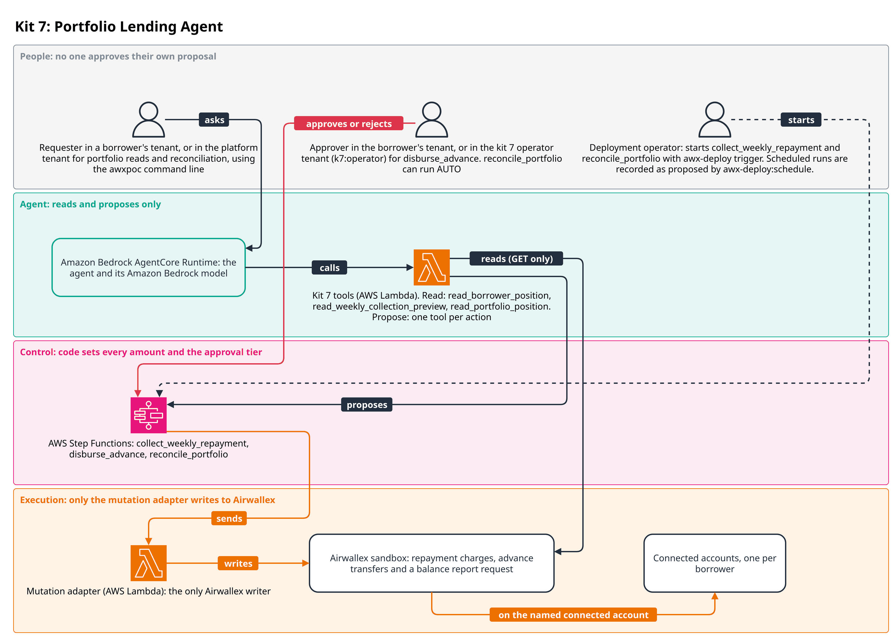
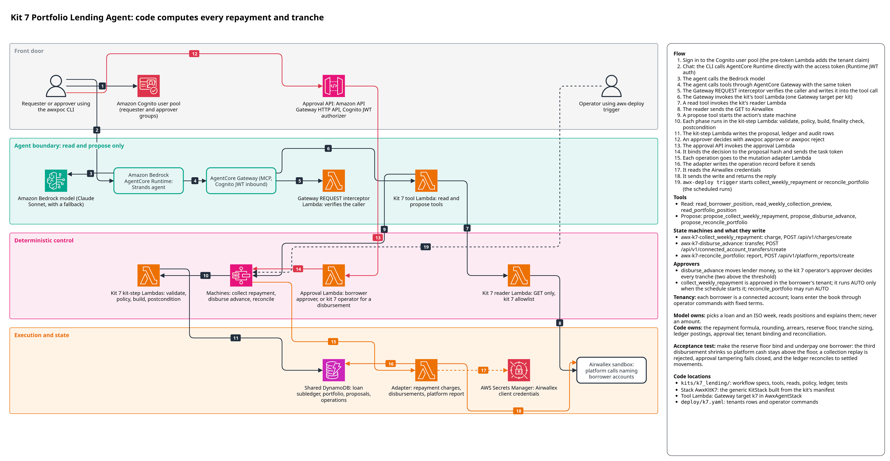

# Kit 7: Portfolio Lending Agent

A platform makes revenue-based advances to borrowers who each hold an Airwallex connected
account. Every week it must collect a share of each borrower's revenue, record any shortfall
as arrears, and decide whether the next underwritten advance can be paid in full, in part or
not yet, without letting platform cash fall below the portfolio's reserve floor. This kit does
that on Airwallex: code sizes every charge and tranche from a loan subledger, a person (the
kit's operator) approves every advance, and the subledger is reconciled to the Airwallex
movements it sent. The guide does not specify the loan subledger, the repayment formula or the
reconciliation, so those are AWS-authored assumptions, labelled as such here and in
[DESIGN.md](DESIGN.md).



A requester in a borrower's tenant asks the agent, which reads the borrower's position and the
weekly collection preview and proposes a collection or an advance. Code in AWS Step Functions
computes every repayment and tranche and sets the approval tier. An approver in the kit 7
operator tenant (`k7:operator`) decides every `disburse_advance`, and an approver in the
borrower's tenant decides a collection the model starts. The proposer never approves their own
proposal. `reconcile_portfolio` can run AUTO. `read_portfolio_position` and
`reconcile_portfolio` run in the platform tenant only. A deployment operator starts the
scheduled collection and reconciliation with `awx-deploy trigger`. Only the mutation adapter
writes to Airwallex.

The detailed reference architecture follows.



The diagram source is `docs/architecture/k7_lending.drawio`.

## Flow
1. An operator opens the portfolio, loads each borrower's loan terms and earmarks capital
   with the kit's operator commands (`awx-deploy apply deploy/k7.yaml`). Loans never come
   from the model.
2. A borrower asks the agent for an advance. The agent calls `propose_disburse_advance` with
   only a `loan_id`; the borrower's tenant and connected account are resolved server-side. If
   the borrower does not name the loan, the agent reads it first: `read_borrower_position`
   without a `loan_id` returns the caller's own loan id (`your_loan_ids`, each borrower tenant
   has one loan) and its position, and never another borrower's. The borrower cannot choose
   the amount: a borrower who asks for 2,000 USD gets the tranche that
   code sizes, and the tool's description and result say so.
3. Policy code sizes the next tranche from `min(ledger cash, live platform balance)` minus
   tranches in flight: the full remaining commitment, a partial tranche rounded down to the
   increment, or a delay. It hashes the amount into the proposal and starts `awx-k7-disburse_advance`.
   A loan can be advanced up to its `commitment` in total, never more. The remaining
   commitment is the commitment less every tranche disbursed, and repayments do not restore
   it, so once a loan's commitment is fully disbursed every further advance is BLOCKED
   ("commitment fully disbursed"). In `deploy/k7.yaml` each loan has an 8,000 USD commitment:
   one full advance uses all of it, so a second advance demo needs the other loan, loan-c, and
   a requester in its tenant.
4. An approver in the `k7:operator` tenant approves the proposal (SINGLE, or DUAL above the
   dual-approval threshold). The build re-checks the plan, holds the tranche in the book and
   sends a `connected_account_transfers/create` from the platform to the borrower.
5. The finality poll waits for SETTLED; the postcondition posts the DISBURSEMENT entry
   (principal plus the fixed fee as unearned) and checks the ledger stays above the floor.
6. After each collection week ends, a scheduled run (`awx-deploy trigger`) or the agent
   (`propose_collect_weekly_repayment`) starts `awx-k7-collect_weekly_repayment`. Code reads
   the week's external deposits and the borrower's wallet, applies the bounded revenue-share
   formula, holds the charge and sends `charges/create` from the borrower to the platform.
7. When the charge is terminal the postcondition closes the week: what settled is cash, what
   did not is arrears, never a second charge.
8. `awx-k7-reconcile_portfolio` reads back every request_id the book sent, checks the ledger
   invariants and the platform balance, records the result and requests a balance report.

## Model and code responsibilities
The model picks a `loan_id` and a collection week, reads positions and explains them. It never
supplies or computes an amount, an account, a tranche number or a request_id: the tool schemas
have no such field and validation refuses unknown fields. Underwriting and loan ranking are out
of scope; loans enter the book through an operator with their terms fixed.

Code owns the repayment formula, rounding, arrears, the reserve floor, tranche sizing, ledger
postings, the approval tier, tenant binding and reconciliation. No read output carries an
`acct_` id, and a borrower never sees platform-wide figures.

## Actions and tools

| Tool | Kind | Starts | Lowest tier when the agent proposes |
|---|---|---|---|
| `read_borrower_position` | READ | - | - |
| `read_weekly_collection_preview` | READ | - | - |
| `read_portfolio_position` | READ (platform scope) | - | - |
| `propose_collect_weekly_repayment` | PROPOSE | `awx-k7-collect_weekly_repayment` | SINGLE |
| `propose_disburse_advance` | PROPOSE | `awx-k7-disburse_advance` | SINGLE |
| `propose_reconcile_portfolio` | PROPOSE (platform scope) | `awx-k7-reconcile_portfolio` | AUTO |

The tools are defined in `src/awx_k7_lending/tools.py`, the workflows in `workflow.py` and the
reads in `reads.py`. The platform-scope tools are refused when the agent calls them as a
borrower or with no tenant claim.

## Approval rules

| Tier | When |
|---|---|
| BLOCKED | no portfolio open; the tenants row disagrees with the seeded account; a collection for anything but the loan's next collectible week, a week not yet ended, or a repaid loan; a disbursement delayed by the reserve floor or with the commitment used; a hold unresolved past 6 days |
| DUAL | a disbursement above `dual_approval_above` |
| SINGLE | every other disbursement, from any origin; a collection the model starts |
| AUTO | a scheduled collection (origin SCHEDULE) inside the operator-approved cap, due and wallet; any reconciliation (it moves no money) |

Disbursements are approved by the kit's operator (`k7:operator`); the borrower's own approver
can read an advance proposal but cannot approve it. Collections are approved by the requester's
own approver. Reconciliation is AUTO and needs no approval. It is the only kit 7 action whose
spec lowers the agent floor to AUTO, because it only reads back and reports (plus a balance
report request). The platform-scope tools answer only a tenant with no connected
account (`k7:operator`); the deployment creates no such requester, so run reconciliation with
`awx-deploy trigger`. Details and the reasons for each tier are in
[DESIGN.md](DESIGN.md#approval-rules-in-detail).

## Money safety

- Request ids derive from business keys (`<book>:collect:<loan>:<week>:<attempt>`,
  `<book>:disburse:<loan>:<tranche>:<attempt>`), never from amounts; the book id is minted per
  portfolio, so a new book never reuses an earlier run's ids (rule M2).
- A charge or tranche is held in the book before it is sent. While held, the next proposal
  re-sends the same operation unchanged; the attempt moves only after a definitive failure
  (rule M1), and only the run that placed a hold treats a refusal as definitive (rule M4).
- Ledger postings happen only from a terminal provider read. An insufficient-funds charge
  becomes arrears; arrears are never re-charged, only paid down by later capped collections.
- After an unknown outcome the money stays in flight on its request_id; codes a resend cannot
  change, and any object under the kit's request_id with another amount or account, go to a person.
  A hold older than 6 days is never re-sent.
- Tranches never take platform cash below the reserve floor, sized against both the ledger and
  the live balance.
- Reconciliation reads back only this book's own request_ids, so other objects on a shared
  account are out of scope.

## Infrastructure

`AwxKitK7` is the generic `KitStack` built from this kit's manifest (see
[infra/README.md](../../infra/README.md)). It deploys one root state machine per action and no
child machines: `awx-k7-collect_weekly_repayment`, `awx-k7-disburse_advance` and
`awx-k7-reconcile_portfolio`, each with its own kit-step Lambda
(`awx_spine_aws.handlers.kit_step.handler`, no Airwallex secret), log groups and failed and
timed-out alarms. Kit 7 declares no extra functions and no EventBridge schedule.

In `AwxAgentStack` it adds the `K7ToolsHandler` tool Lambda (read and propose only) and the
AgentCore Gateway target `k7`. In `AwxSpine` the kit's reader (`ReaderK7Fn`) may call only
these GET paths:

| Scope | Paths under `/api/v1/` |
|---|---|
| borrower (with `x-on-behalf-of`) | `balances/current`, `balances/history`, `charges`, `charges/{id}`, `connected_account_transfers`, `connected_account_transfers/{id}` |
| platform (headerless) | `balances/current`, `charges`, `charges/{id}`, `connected_account_transfers`, `connected_account_transfers/{id}` |

Synth or deploy only this kit:

```
make synth ACCOUNT=111122223333 ALERT_EMAIL=you@example.com KITS=k7
make deploy ACCOUNT=<12-digit id> ALERT_EMAIL=<address> KITS=k7
```

A partial deploy over a full one removes the other kits' tools from the agent.

## Setting up a deployed kit

Follow [docs/deployment.md](../../docs/deployment.md), then for kit 7:

1. Create the borrowers' `poc-i7-` connected accounts and bring them to ACTIVE, and note their
   ids and the borrowers' Cognito `tenant_id` values.
2. Fund the platform wallet in USD with a sandbox deposit, under `flock /tmp/awx-sandbox.lock`,
   and note the deposit id.
3. Run `uv run --all-packages awx-deploy --profile <profile> apply deploy/k7.yaml`, passing
   each variable with `--var`: `K7_TENANT_LOAN_A`, `K7_TENANT_LOAN_C`, `K7_ACCT_LOAN_A`,
   `K7_ACCT_LOAN_C`, `K7_FIRST_PERIOD` and `K7_DEPOSIT_ID`. It writes the tenants rows
   (`k7:operator` and one per borrower) and runs `open_portfolio`, `add_loan` twice and
   `fund_capital`.

   `K7_FIRST_PERIOD` is `DEMO300S-<n>`, where period n starts at 2026-01-01T00:00Z + n x 300 s
   ([DESIGN.md](DESIGN.md#demo-collection-periods)). Use the period running now. It is the
   earliest period a collection may cover; the first collection is for the first period that
   starts once the advance has settled, so an earlier n changes nothing and a later n only delays
   the first collection. This prints the current period:

   ```
   python3 -c "import time; print(f'DEMO300S-{(int(time.time()) - 1767225600) // 300}')"
   ```

   `1767225600` is 2026-01-01T00:00Z in Unix seconds. After the advance, `read_borrower_position`
   shows the next period to collect (`next_collectible_week`).
4. Create demo users: a requester and an approver in each borrower tenant, and an approver in
   `k7:operator` for advances.
5. Start collections and reconciliations with `awx-deploy trigger` (see
   [DESIGN.md](DESIGN.md#starting-scheduled-actions)).

## Tests

```
uv run --all-packages pytest kits/k7_lending/tests -m "not sandbox and not synth and not live"
```

| File | What it proves |
|---|---|
| `test_money_rules.py` | the formula, rounding, tranche sizing, ledger postings and book rules, with property tests |
| `test_scenarios.py` | every action through `local_runner.run_kit_workflow` against `FakeAirwallex`: the required acceptance test, platform binding, reconciliation scope, collection order, revenue, approvals, every runner fault and rules M1 to M4 |
| `test_tool_surface.py` | the tools through the real dispatcher (`KitToolHarness`): approval bound to the proposal hash, tenant isolation, a borrower finding only its own loan id, no model-chosen amount, account or request_id, no platform figure for a borrower |
| `test_operator_commands_k7.py` | seeding through the operator commands only, then the tools and the disbursement end to end; command refusals write nothing |
| `test_contract.py` | every propose tool has a spec and every read tool a read; read allowlists |
| `test_synth_k7.py` (marker `synth`) | one machine per action, only the kit-step Lambda, and Build retries never cover kit errors |
| `test_sandbox_acceptance.py` (marker `sandbox`) | the acceptance scenario under the shared sandbox lock, run against the fake |

`make synth-test` runs the synth tests and `make sandbox-test` the sandbox-marked tests. The
sandbox-marked scenario is not wired to the live sandbox. With `AWX_K7_LIVE=1` the live probe
stubs (refused-charge request_id reuse and the `balances/history` row shape) run and raise
`NotImplementedError`; they are not implemented. See [docs/testing.md](../../docs/testing.md).

## Validation

- Live sandbox, 6 Oct 2026 (UTC): the acceptance scenario ran on AirwallexClient with a demo
  book of 60 s periods, driven by a script that is not part of this repository. It paid
  advances of 8,000, 5,000 and 2,300 USD. The last was cut by the reserve floor, leaving ledger
  cash at 5,050.00 against a 5,000.00 floor. It collected repayments of 200 and 150 USD and
  blocked re-runs of each collection. It refused a forged hash, an edited intent and an edited
  amount, and reconciled clean with every movement SETTLED.
- Deployed agent, 7 Oct 2026: a borrower requester's agent proposed an 8,000 USD advance (plus
  the kit's 640 USD fee). That deployment let a customer approver decide an advance: the
  borrower tenant's approver approved it and it settled. The same approver then approved the
  200 USD weekly floor repayment, which settled. Advances are approved by the `k7:operator` approver; the next run
  exercised that path.
- Deployed agent, 7 Oct 2026, on a deployment that routes advances to the `k7:operator`
  approver: on a partial 7,200 USD advance the borrower's approver was refused and the
  `k7:operator` approver approved it; it settled.
- Deployed agent, 8 Oct 2026, on a deployment from a fresh clone into a new account: a
  borrower requester asked for 2,000 USD and the agent proposed the 8,000 USD tranche, with a
  640 USD fee, because code sizes the tranche. The `k7:operator` approver approved it and the
  run SUCCEEDED. That advance used all of loan-a's 8,000 USD commitment. A 200 USD weekly
  collection started with `awx-deploy trigger` ran at AUTO, and `reconcile_portfolio` ran.
- Deployed agent, 8 Oct 2026, on the same deployment: a borrower requester for loan-c asked
  for 2,000 USD. The kit sized a 7,200.00 USD partial tranche because the reserve floor binds,
  and the agent reported that amount with the reason the tool returned. The proposal was not
  approved.
- Not validated live: borrower revenue (the live runs had none, so every collection took the
  floor), the under-paying borrower, the `balances/history` row shape, insufficient-funds,
  FAILED and SUSPENDED movements, and DUAL approval. These are covered against the fake only.

## Assumptions and limits

- The loan subledger, repayment formula, fee and reconciliation invariants are AWS-authored
  assumptions; the guide gives none ([DESIGN.md](DESIGN.md#aws-authored-assumptions)).
- The reserve is a policy threshold on the platform wallet; Airwallex has no reserve object.
- Revenue is read from `balances/history` DEPOSIT rows, whose shape is unprobed live; a
  shape-independent backstop keeps the advance out of revenue and can only under-collect.
- Underwriting is out of scope: loans are loaded by an operator with fixed terms.
- References use the runtime prefix `poc-k7-<book>-`; setup objects carry `poc-i7-`.
- `platform_reports/create` takes no request_id, so a lost response can create a second
  report (it moves no money).
- No schedule is deployed: weekly collections start from `awx-deploy trigger` or the agent.
- Demo books use short labelled periods (`DEMO<s>S-<n>`) so a live demo closes a period in
  minutes ([DESIGN.md](DESIGN.md#demo-collection-periods)).
