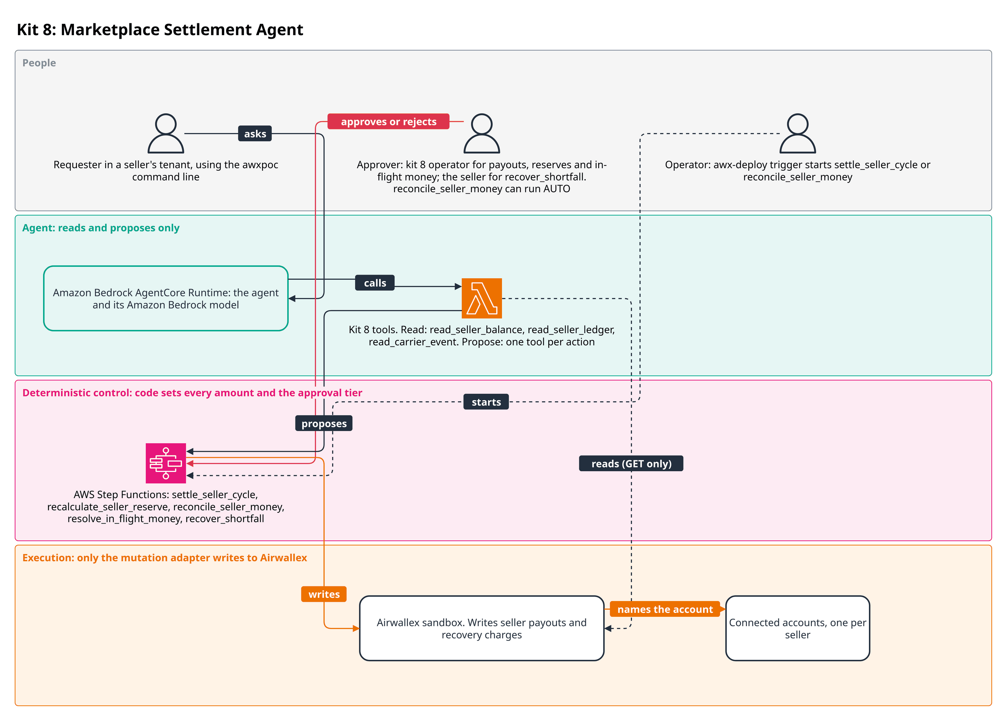
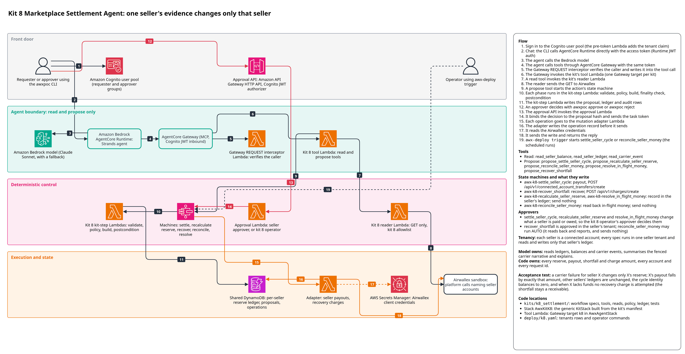

# Kit 8: Marketplace Settlement Agent

A marketplace platform collects buyer payments and settles three sellers who hold Airwallex
connected accounts. Each cycle it must pay each seller their net earnings, keep a reserve
against that seller's refund risk, and release reserve when the risk falls. Carrier evidence
about one seller (lost or delayed parcels) must raise that seller's reserve and nobody
else's. Refunds beyond a seller's cash and reserve leave the seller owing the platform. This
kit keeps a per-seller reserve ledger whose identities balance on every posting, pays each
seller through a connected account transfer, turns any shortfall into a receivable, and
collects it with a separate, always-approved charge only when the seller's wallet can cover it.



A requester in a seller's tenant asks the agent, which reads that seller's balance, ledger and
carrier events and proposes settlement, reserve, recovery and reconciliation actions. Code in
AWS Step Functions sets every reserve, payout and charge amount and the approval tier. An
approver in the kit 8 operator tenant (`k8:operator`) decides payouts, reserve changes and
in-flight money, and an approver in the seller's tenant decides `recover_shortfall`. The
proposer never approves their own proposal. `reconcile_seller_money` can run AUTO. A deployment
operator starts the scheduled settlement and reconciliation with `awx-deploy trigger`. Only the
mutation adapter writes to Airwallex.

The detailed reference architecture follows, and [DESIGN.md](DESIGN.md) holds the design notes.



The diagram source is `docs/architecture/k8_settlement.drawio`.

## Flow
1. An operator seeds each seller (book id, profile, the checked connected account) and loads
   orders, carrier events and cycle figures with the kit's operator commands through
   `awx-deploy` (`deploy/k8.yaml`).
2. A person asks the agent about a seller; the agent calls `read_seller_ledger`,
   `read_seller_balance` or `read_carrier_event` and explains the figures.
3. The agent calls `propose_settle_seller_cycle` (or `propose_recalculate_seller_reserve` for
   a carrier event). Code computes the payout, reserve target, shortfall and any netting, and
   sets the risk tier.
4. The proposal starts `awx-k8-settle_seller_cycle` (or `awx-k8-recalculate_seller_reserve`).
   Above AUTO it waits for the kit 8 operator's approval, bound to the proposal hash.
5. The build posts the cycle to the ledger and returns one `connected_account_transfers/create`
   from the platform to the seller, under a request id built from the seller's book id and the
   cycle. The mutation adapter sends it.
6. The postcondition reads the transfer back. SETTLED posts `paid_out`; a definitive failure
   makes the payout `payable` in a later cycle; anything else stays in flight on the same
   request id.
7. A shortfall becomes a receivable. `propose_recover_shortfall` starts
   `awx-k8-recover_shortfall`; the seller's approver approves one `charges/create` from the
   seller's wallet, made only if the wallet covers the whole receivable.
8. `propose_reconcile_seller_money` (`awx-k8-reconcile_seller_money`) reads back everything in
   flight and records definitive outcomes. Money still unknown past the deduplication window
   goes to a person through `propose_resolve_in_flight_money`
   (`awx-k8-resolve_in_flight_money`).

## Model and code responsibilities
The model reads ledgers, balances and carrier events, summarises the carrier narrative and
explains decisions. Its tool inputs are identifiers only (`cycle_id`, `carrier_event_id`,
`currency`, and the resolve tool's `kind`, `ref`, `resolution`, `evidence_ref`). The carrier
narrative reaches it fenced as untrusted text.

Code computes every reserve, payout, shortfall and charge amount, takes the seller's account
from the server-resolved tenant, derives every request id, sets every tier, and never parses
the carrier narrative.

## Actions and tools

| Tool | Kind | Starts | Lowest tier when the agent proposes |
|---|---|---|---|
| `read_seller_balance` | READ | - | - |
| `read_seller_ledger` | READ | - | - |
| `read_carrier_event` | READ | - | - |
| `propose_settle_seller_cycle` | PROPOSE | `awx-k8-settle_seller_cycle` | SINGLE |
| `propose_recalculate_seller_reserve` | PROPOSE | `awx-k8-recalculate_seller_reserve` | SINGLE |
| `propose_recover_shortfall` | PROPOSE | `awx-k8-recover_shortfall` | SINGLE |
| `propose_reconcile_seller_money` | PROPOSE | `awx-k8-reconcile_seller_money` | AUTO (sends nothing; justified in [DESIGN.md](DESIGN.md#approval-matrix)) |
| `propose_resolve_in_flight_money` | PROPOSE | `awx-k8-resolve_in_flight_money` | DUAL (always) |

## Approval rules

| Action | Approver | AUTO | SINGLE | DUAL | BLOCKED |
|---|---|---|---|---|---|
| `settle_seller_cycle` | kit 8 operator | reserve unchanged, released or raised non-materially; a resend | material reserve increase; netting; a new receivable | payout, increase or netting >= 10,000 | bad or missing data, account mismatch, already settled, a watch holds it |
| `recalculate_seller_reserve` | kit 8 operator | no change, or a non-material increase | material increase | increase >= 10,000 | evidence names another seller; malformed evidence |
| `recover_shortfall` | seller's own approver | wallet short (no charge); a resend | every new charge | charge >= 10,000 | nothing owed; past the window |
| `reconcile_seller_money` | seller's own approver | always | - | - | nothing in flight |
| `resolve_in_flight_money` | kit 8 operator | - | - | always | not in flight, inside the window, or Airwallex shows the object |

A material increase is more than 500, more than 25% of the reserve before, or any increase from
zero. A resend is AUTO at policy level, but a resend the model starts still waits for one
approval. The full matrix is in [DESIGN.md](DESIGN.md#approval-matrix).

## Money safety

- Request ids are `payout:<book>:<seller>:<cycle>` and `recovery:<book>:<seller>:<attempt>`,
  with a random book id minted once per seller, so a re-run on the shared sandbox never adopts
  an earlier run's objects.
- Money with no definitive outcome stays in flight on its original request id (rule M1): never
  payable, never re-paid in a later cycle, never netted twice. Resends reuse the same request id
  and body, inside a 6-day margin of Airwallex's deduplication window of about 7 days.
- The ledger, its posting keys and recovery claims share one versioned item, so a settlement
  that nets a receivable and a charge that collects it can never both win.
- Every operation is a platform call naming the seller in its body, never sent with
  `x-on-behalf-of`, and checked with `check_tenant_scope`; every action first checks that the
  tenants row names the account seeded for that seller.
- Past the window the kit sends nothing and flags a person. A person's `not_landed` decision is
  watched with no time limit, and settlement and recovery stay blocked until a later read and a
  counterparty scan confirm nothing landed.

Detail: [DESIGN.md](DESIGN.md) ("Resolving a payout or a charge", "Watches on `not_landed`").

## Infrastructure

The generic `KitStack` builds `AwxKitK8` from the kit's manifest; kit 8 writes no CDK and
declares no extra functions. From the synthesised templates:

| Stack | Resources |
|---|---|
| `AwxKitK8` | root state machines, one per action: `awx-k8-settle_seller_cycle`, `awx-k8-recalculate_seller_reserve`, `awx-k8-recover_shortfall`, `awx-k8-reconcile_seller_money`, `awx-k8-resolve_in_flight_money` (no child machines); one step Lambda per action (60 s, 512 MB, no Airwallex secret); a failed and a timed-out CloudWatch alarm per machine |
| `AwxAgentStack` | the `K8ToolsHandler` tool Lambda (read and propose only) and its AgentCore Gateway target, "Marketplace Settlement Agent read and propose tools" |
| `AwxSpine` | the kit 8 reader (`ReaderK8Fn`), allowed platform `GET /api/v1/connected_account_transfers`, `/api/v1/connected_account_transfers/{id}`, `/api/v1/charges`, `/api/v1/charges/{id}`, and tenant `GET /api/v1/balances/current` |

To synth or deploy only this kit, with `REGION` set to `us-west-2` or the Region of the
deployment being updated:

```
export REGION=us-west-2
make synth ACCOUNT=111122223333 ALERT_EMAIL=you@example.com KITS=k8 REGION="$REGION"
make deploy ACCOUNT=<12-digit id> ALERT_EMAIL=<address> KITS=k8 REGION="$REGION"
```

A partial deploy over a full one removes the other kits' tools from `AwxAgentStack`. See
[infra/README.md](../../infra/README.md).

## Setting up a deployed kit

1. Find or create the `poc-i8-seller-alice`, `-bob` and `-cara` connected accounts (ACTIVE,
   labelled `poc-i8-`) and note their ids.
2. Pass the ids as `K8_ACCT_ALICE`, `K8_ACCT_BOB` and `K8_ACCT_CARA` with `--var`, first to
   `plan`, then to `apply`:

   ```
   uv run --all-packages awx-deploy plan deploy/k8.yaml --var K8_ACCT_ALICE=acct_... --var K8_ACCT_BOB=acct_... --var K8_ACCT_CARA=acct_...
   uv run --all-packages awx-deploy --profile <profile> apply deploy/k8.yaml --var K8_ACCT_ALICE=acct_... --var K8_ACCT_BOB=acct_... --var K8_ACCT_CARA=acct_...
   ```

   `apply` writes one tenants row per
   seller (kit `k8`, role `customer`, the seller's account) and runs `seed_seller` and
   `load_cycle` (cycle `c1`) for each seller. Load order books and carrier events with
   `awx-deploy run` (`load_orders`, `load_carrier_events`) when a scenario needs them.
3. After each `load_cycle`, deposit the cycle's net buyer money (entitlement minus refunds,
   summed over sellers) into the platform wallet, under `flock /tmp/awx-sandbox.lock`.
4. Create demo users: a requester and an approver per seller tenant, and an approver with
   tenant `k8:operator` for the operator-approved actions.

Command arguments and repair steps are in [DESIGN.md](DESIGN.md#operator-commands); the
general procedure is in [docs/deployment.md](../../docs/deployment.md).

## Tests

Offline tests run kit 8 through `awx_spine_aws.local_runner.run_kit_workflow` against
`FakeAirwallex`, the same engine and adapter code the Lambdas run. `tests/conftest.py` holds the
`Market` fixture (three sellers, in-memory or `DynamoDbKitStore` on moto) and `KitPort`, a thin
wrapper for end states the fake and the sandbox cannot produce.

| File | Proves |
|---|---|
| `test_ledger.py`, `test_reserve.py`, `test_evidence.py` | ledger identities (hypothesis), reserve formula and bounds, strict evidence parse and the fenced narrative |
| `test_operations.py`, `test_contract.py` | operation builders, request ids, outcome mapping, spec contract |
| `test_scenarios.py` | the acceptance test, tiers and approvals, every payout and charge outcome |
| `test_spine_faults.py` | every spine fault (timeouts, list lag, 500s, 429s, crashes, dedupe expiry, uncertain sends) pays and collects exactly once |
| `test_oracle.py` | the real runner agrees with an independent oracle over generated fault sequences |
| `test_race_dynamodb.py` | netting versus recovery on DynamoDB, both orders, a crash, two threads |
| `test_resolve.py` | the resolve tool, watches, adoption and the counterparty scan |
| `test_tools.py` | every tool through `KitToolHarness` (signed tokens, tenant from the token, refused smuggled inputs) |
| `test_operator_commands.py` | state seeded only through operator commands runs every tool and action; account binding |

`test_synth_k8.py` (marker `synth`, `make synth-test`) synthesises the stacks and checks one
state machine per action, no extra functions, and the Build retry budget the adoption wait
assumes.

`test_acceptance_sandbox.py` (marker `sandbox`, `make sandbox-test`) is the guide's acceptance
scenario plus a second-run test. As committed it runs on `FakeAirwallex`; it holds
`flock /tmp/awx-sandbox.lock`, reuses `poc-i8-seller-<name>` accounts by label, mints fresh book
ids and ends with nothing NEW or PENDING. See [docs/testing.md](../../docs/testing.md).

## Validation

- Live sandbox, 6 Oct 2026 (UTC): the acceptance scenario ran against the sandbox, driven by a
  copy of `test_acceptance_sandbox.py` with the fake swapped for the sandbox client; that copy
  is not part of this repository. It paid 17,860 USD to three sellers (9,300; 4,760 after a
  3,000 carrier-failure reserve; 3,800), every cycle balanced, a refund surge recorded a 1,000
  receivable and sent nothing, one seller was blocked from using another seller's carrier
  event, and reconcile found nothing in flight. The "seller has no funds" step behaved
  differently: the seller's wallet still held its payout, so the kit proposed a 1,000 charge,
  which was left unapproved.
- Deployed stack, 7 Oct 2026: a payout run started with `awx-deploy trigger` and approved by
  the seller's own approver through the approval API settled 3,800 USD to one seller with
  1,000 USD held as reserve. That deployment predates the rule that the kit 8 operator approves
  settlement.
- Deployed agent, 7 Oct 2026: a read tool returned the seller's sandbox figures.
- Deployed stack, 8 Oct 2026, on a deployment from a fresh clone into a new account:
  `awx-deploy trigger k8 settle_seller_cycle` for one seller's cycle needed SINGLE approval (a
  material reserve increase of 1,000 USD) from the `k8:operator` approver. The seller's own
  approver was refused with HTTP 403 and the kit 8 operator approved it. The run SUCCEEDED,
  paying 3,800 USD to the seller with 1,000 USD held in reserve, and the agent, signed in as
  that seller, read the balance and ledger.

Not validated live: recovery charges, the resolve tool
and watches, and SUSPENDED or FAILED end states (the sandbox cannot produce them).

## Assumptions and limits

- The platform is the authorised marketplace (merchant of record) and sellers have agreed to a
  reserve and to recovery charges.
- Refunds are cycle inputs the platform has already paid; the flow has no buyer-refund call.
- The kit never charges part of a receivable.
- Both calls use reason `goods_purchased`. Neither call is expected to reach CANCELLED; if one
  does, the kit treats it as a failure.
- Materiality and the reserve formula are AWS-authored policy constants.
- One currency per seller.
- A `not_landed` decision relies on Airwallex's reads: if Airwallex never shows an object that
  landed, the kit cannot detect it.

Detail: [DESIGN.md](DESIGN.md#guide-ambiguities-and-the-reading-taken) and
[DESIGN.md](DESIGN.md#sandbox-limits).
